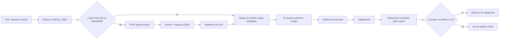

# Oscila — Guía técnica para el foro

Guía para presentar Oscila y responder preguntas sobre cómo está programada. Todo sale del código del repositorio (rama `contenido/creditos`, 16 de octubre de 2026). Lo que el código no permite saber está marcado como **[completar por el equipo]**.

---

## 1. Oscila en 1 minuto

> **En sencillo:** Oscila es una página web para aprender física. Su parte principal deja dibujar un circuito (o tomarle una foto a uno hecho a mano) y lo resuelve paso a paso, como en el cuaderno.

- **Qué es:** una plataforma educativa con tres módulos. **Electricidad y Magnetismo** es el principal; **Calor y Ondas** está "en revisión"; **Mecánica** está marcada como "próximamente" (`src/contenido/modulos.js`).
- **Para qué sirve:** estudiar teoría, ver aplicaciones en ingeniería, practicar con ejercicios resueltos, hacer un test y, sobre todo, resolver circuitos propios en el **montaje virtual**.
- **Qué la hace distinta:**
  - el editor de circuitos y el motor de cálculo son **propios**, no una librería externa;
  - la solución se escribe **como la haría un estudiante**: fórmulas, despejes, números en SI, ecuaciones numeradas y sentido real de las corrientes;
  - **cada número que se muestra se comprueba** con un segundo método independiente (análisis nodal). Si no coincide, la solución no se muestra;
  - reconoce **fotos de circuitos dibujados a mano** con IA, y el usuario confirma o corrige lo leído antes de calcular;
  - funciona **sin internet**, salvo el reconocimiento de fotos nuevas.
- **Quiénes la hicieron** (`src/contenido/creditos.js`):
  - Electricidad y Magnetismo: **Juan Sebastian Martinez, Juan David Rivera y Eduardo Enrique Vergara**. Profesor: **Jarvin Mestra Páez**. Universidad del Magdalena, II Foro Internacional de Física.
  - Calor y Ondas: módulo original del equipo del profesor **Jean Linero Cueto**, con 11 integrantes (`src/contenido/calor-ondas/creditos.js`).
- **Lema:** "Física que se ve y se calcula".

---

## 2. Tecnologías y lenguajes

> **En sencillo:** Oscila es una aplicación web. Está escrita en JavaScript, el lenguaje de los navegadores, y usa piezas de software libre para las fórmulas, el PDF y la validación de datos.

- **React:** una librería para construir la interfaz como piezas reutilizables ("componentes") que se vuelven a dibujar solas cuando cambian los datos.
- **Vite:** la herramienta que sirve la app mientras se programa y que la empaqueta en archivos optimizados para publicarla.

| Tecnología | Para qué se usa | Dónde |
|---|---|---|
| JavaScript / JSX | Toda la lógica y las pantallas. JSX es JavaScript con etiquetas tipo HTML. | `src/**/*.js`, `src/**/*.jsx`, `api/*.js` |
| CSS | Estilos neo-brutalistas con variables de diseño (colores, bordes, espacios) | `src/estilos/tokens.css`, `src/index.css`, un `.css` por página |
| HTML | Una sola página donde React monta la app | `index.html` |
| React 18 (MIT) | Interfaz por componentes y estado | `src/App.jsx`, `src/pages/`, `src/components/` |
| Vite 5 (MIT) | Desarrollo (`npm run dev`), empaquetado (`npm run build`) y servidor local de `/api/reconocer` | `vite.config.js` |
| KaTeX (MIT) | Fórmulas matemáticas, con fuentes locales (sin CDN) | `src/components/Tex.jsx`, `src/main.jsx` |
| react-markdown + remark-math + remark-gfm + rehype-katex (MIT) | Mostrar texto en Markdown con fórmulas y tablas | `src/components/Markdown.jsx` |
| Zod (MIT) | Validar con un esquema la netlist y el JSON que devuelve la IA | `src/circuitos/netlist.js`, `src/circuitos/reconocimiento.js` |
| jsPDF (MIT) | Generar el "Plan de estudio" en PDF del test | `src/pages/TestInteractivo.jsx`, `src/pages/calor-ondas/Test.jsx` |
| Vitest | Pruebas automáticas (110) | `*.test.js` en `src/` y `api/` |
| Playwright | **No está en el proyecto.** Se usó fuera del repositorio para capturas y revisiones visuales. | — |
| Función serverless (Vercel) | Recibe la foto y llama a Gemini con la clave secreta | `api/reconocer.js`, `api/_nucleo.js` |
| API de Gemini (Google) | Lee el circuito de la foto y devuelve JSON | `api/_nucleo.js` (modelo por defecto `gemini-3.5-flash-lite`) |
| IndexedDB (del navegador) | Guarda los reconocimientos ya hechos para no repetirlos | `src/components/foto/almacen.js` |
| localStorage | Contador de solicitudes del día y modo feria | `almacen.js`, `src/components/ModoFeria.jsx` |
| Lexend (SIL OFL 1.1) | Tipografía, instalada como paquete (sin Google Fonts) | `@fontsource-variable/lexend` en `src/main.jsx` |

---

## 3. Estructura del proyecto y navegación

> **En sencillo:** el código está separado en "el cerebro" (cálculos de circuitos), "las pantallas" y "el contenido" (textos, ejercicios, preguntas). La app no cambia de dirección web: guarda en memoria qué pantalla se está viendo.

```
api/                      función serverless de reconocimiento (Vercel) y sus pruebas
  reconocer.js              punto de entrada POST /api/reconocer
  _nucleo.js                llamada a Gemini, manejo de errores, validación
src/
  main.jsx                  arranque: KaTeX, Lexend, estilos y <App/>
  App.jsx                   navegación por estado y marco general
  circuitos/                núcleo de cálculo, sin React (se puede probar solo)
    geometria.js netlist.js   dibujo → netlist (union-find)
    clasificacion.js          serie / paralelo / mixto / no reducible
    reduccion.js              árbol de reducciones y regreso
    kirchhoff.js mallas.js    ecuaciones de nodo y de malla
    sistemas.js lineal.js     sustitución o Gauss paso a paso
    mna.js                    verificador (análisis nodal modificado)
    pasos.js                  arma la solución y la verifica
    layout.js Esquema.jsx     dibujo automático de los esquemas
    reconocimiento.js         esquema JSON, prompt y JSON → dibujo
    unidades.js               "4,7 kΩ" → 4700
  components/               barra lateral, editor, foto, Markdown, KaTeX, modo feria
  pages/                    una página por sección (+ calor-ondas/)
  contenido/                teoría, aplicaciones, 15 ejercicios .md, test, créditos, imágenes
  estilos/tokens.css        colores, bordes, sombras y tipografía
public/                     imágenes (aplicaciones/, calor-ondas/), favicon y escudo
paquete_EyM/                material fuente: ejercicios, hoja de fórmulas, casos de prueba
```

**Cómo se navega** (`src/App.jsx`):

- Un estado `activePage` guarda la página actual. El objeto `PAGES` traduce cada nombre a un componente: `inicio`, `teoria`, `ejemplos`, `montaje`, `ejercicios`, `test`, `creditos` y las seis `co-*` de Calor y Ondas.
- **No hay rutas en la URL** (no se usa react-router). Recargar vuelve a la portada y el botón "atrás" del navegador no cambia de sección.
- **Barra lateral** (`src/components/BarraLateral.jsx`):
  - arriba, los módulos;
  - en el medio, las secciones del módulo activo. Si la página empieza por `co-`, muestra las de Calor y Ondas;
  - abajo, "Créditos" y "Modo feria".
- **En celular** (menos de 1024 px), la barra se vuelve un cajón que abre el botón "Menú". El foco queda dentro del cajón y Esc lo cierra.

---

## 4. Cada sección

### Portada, Teoría, Aplicaciones y Créditos

> **En sencillo:** son las páginas de lectura. Muestran contenido que está guardado en archivos de texto dentro del proyecto.

- **Portada** (`src/pages/Inicio.jsx`):
  - tarjetas de los tres módulos y accesos con conteos calculados de los datos (4 temas, 15 ejercicios, 4 aplicaciones, 12 preguntas);
  - franja de créditos, que lee de `creditos.js`.
- **Teoría** (`src/pages/Teoria.jsx` + `src/contenido/teoria.js`): 4 temas en Markdown con KaTeX: potencial, capacitancia, resistencia y circuitos, y leyes de Kirchhoff.
- **Aplicaciones** (`src/pages/Aplicaciones.jsx` + `src/contenido/aplicaciones.js`):
  - 4 casos: fuente de 12 V, desfibrilador, caída de voltaje en un cable y divisor con sensor;
  - el divisor trae un botón "Abrir este circuito en el montaje" (`src/circuitos/pendiente.js`).
- **Créditos** (`src/pages/Creditos.jsx`): equipos, inspiración (circuit-diagram.org), tecnologías con licencia e inventario de imágenes. En modo feria oculta lo de Calor y Ondas.

### Ejercicios

> **En sencillo:** los 15 ejercicios resueltos del curso, agrupados por tema. Cada inciso se abre con un clic, para intentarlo primero.

- Cada ejercicio es un archivo Markdown: `src/contenido/ejercicios/ejercicio_01.md` … `_15.md`.
- `src/contenido/ejercicios.js`:
  - los carga con `import.meta.glob` de Vite;
  - lee la sección del comentario `<!-- Sección: … -->`;
  - separa el enunciado de la solución;
  - parte la solución en incisos por cada `### `.
- **Figuras:** 33 SVG en `src/contenido/ejercicios/figuras/`, redibujados con LaTeX/TikZ por el equipo a partir del material del curso.
- **Interfaz** (`src/pages/Ejercicios.jsx`): índice por secciones, incisos colapsables, botones "abrir/cerrar todo" y "Anterior/Siguiente".

### Test

> **En sencillo:** 12 preguntas de opción múltiple. Si te equivocas, te dice qué repasar, y al final descargas un plan de estudio en PDF.

- **Banco de preguntas:** `src/contenido/test.js`. Cada pregunta trae opciones, respuesta correcta, retroalimentación y tema.
- **Lógica** (`src/pages/TestInteractivo.jsx`):
  - seleccionar, verificar y siguiente;
  - ✓ y ✗ como señal accesible de correcto e incorrecto;
  - los temas fallados se acumulan.
- **PDF con jsPDF:** fecha, módulo, profesor, los tres desarrolladores, puntaje, temas a repasar, sugerencias y pie "Oscila - Test de Electricidad y Magnetismo". Se descarga como `Plan_de_Estudio.pdf`.

### Modo feria

> **En sencillo:** un botón (o la tecla F) que pone la app en pantalla completa y con letra grande para mostrarla en la mesa del foro.

- `src/components/ModoFeria.jsx`:
  - agrega la clase `modo-feria` al documento (letra al 125 %) y pide pantalla completa;
  - recuerda el estado en `localStorage`.
- Oculta el módulo Calor y Ondas y sus créditos. Si se activa estando dentro de ese módulo, la app vuelve a la portada (`App.jsx`).
- Muestra en la barra el contador de "Reconocimientos hoy". Cuenta solo las solicitudes hechas desde ese equipo: Google no informa la cuota restante.

### Calor y Ondas

> **En sencillo:** el módulo de la versión anterior de la plataforma, recuperado con el diseño nuevo. Tiene simulaciones animadas de un resorte, un péndulo y resortes en serie y en paralelo.

- **Rutas:** `co-inicio`, `co-teoria`, `co-aplicaciones`, `co-laboratorio`, `co-ejercicios` y `co-test` (`src/pages/calor-ondas/`).
- **Contenido:** el de la etiqueta git `v1-calor-y-ondas`, copiado tal cual.
  - las fórmulas pasaron de MathJax por CDN a KaTeX local;
  - las imágenes sin licencia verificable se reemplazaron por SVG propios;
  - las de Wikimedia Commons llevan su crédito (`src/contenido/calor-ondas/imagenes.js`).
- **Simuladores** (`Laboratorio.jsx`): se dibujan en `<canvas>` con `requestAnimationFrame`, a partir de x(t) = A·cos(ωt), θ(t) = θ₀·cos(ωt) y k_eq en serie o en paralelo.
- **Banner "En revisión"** en todas sus páginas (`BannerRevision.jsx`). Su contenido no se ha corregido.

### Montaje virtual (lo principal)

> **En sencillo:** dibujas el circuito en una cuadrícula o le tomas una foto. La plataforma dice qué tipo de circuito es, lo resuelve paso a paso y comprueba cada resultado por otro camino antes de mostrarlo.

#### a) Editor SVG propio (`src/components/editor/Editor.jsx`)

- **Cuadrícula y herramientas:** seleccionar/mover, cable, fuente, resistencia, condensador, nodo (unión explícita), etiqueta y borrar.
- **Componentes:** miden 4 unidades de cuadrícula (`LARGO` en `geometria.js`) y rotan de 90 en 90 grados.
- **Teclas:** R rota, Supr borra, Ctrl+Z deshace, Ctrl+Y rehace y Esc vuelve a seleccionar.
- **Deshacer y rehacer:** `useHistorial.js` guarda hasta 150 estados. Mientras se arrastra no se guarda; se guarda al soltar.
- **Unidades** (`src/circuitos/unidades.js`): acepta "4.7k", "4,7 kΩ", "10uF", "100 nF" o "12 V", lo convierte a SI y rechaza cero, negativos y unidades equivocadas.
- **Exportar** (`exportar.js`): una copia limpia del SVG se descarga como `.svg` o como `.png` (pasando por un canvas).

#### b) Del dibujo a la netlist (`geometria.js`, `netlist.js`)

- La **netlist** es la lista de elementos con los dos nodos que une cada uno.
- Los cables se parten en las uniones, los cruces y las etiquetas.
- Una estructura **union-find** junta todos los puntos conectados por cables. Cada grupo es un nodo.
- **Nombres de nodo:** si hay etiqueta (a, b, c…) se usa; si no, se numeran N1, N2…
- **Validación con Zod:**
  - nombres repetidos;
  - al menos una fuente y un elemento pasivo;
  - circuito conectado;
  - elementos en cortocircuito (genera un aviso).

#### c) Clasificación (`clasificacion.js`)

| Resultado | Criterio en el código |
|---|---|
| sin fuente | No hay fuente. |
| no reducible (varias fuentes) | Más de una fuente: no existe una única resistencia equivalente. Se resuelve por Kirchhoff. |
| no reducible (puente) | La reducción se atasca: hay elementos que no están ni en serie ni en paralelo con ningún otro. |
| serie | Un solo camino: la raíz del árbol es una serie de elementos originales, o el circuito es un solo elemento. |
| paralelo | Todos los elementos entre los mismos dos nodos, en un solo paso. |
| mixto | Cualquier otra reducción que sí termina. |

- **Resistencias y condensadores juntos:** en DC y estado estacionario los condensadores se tratan como circuito abierto, y se clasifica la red de resistencias.

#### d) Solución por reducción (`reduccion.js`)

1. Desde los bornes de la única fuente, se repiten combinaciones en **serie** (un nodo intermedio con solo dos elementos) y en **paralelo** (mismos dos nodos), quitando antes las ramas colgantes, que no llevan corriente.
2. Cada paso agrupa combinaciones del mismo tipo y genera un "Circuito 2", "Circuito 3"… con nombres como R₁₂ o R_A.
3. Los valores se combinan así: resistencias en serie se suman y en paralelo se suman los inversos; con condensadores es al revés.
4. **Regreso** (`regresar`): desde la raíz, V₀ / R_eq da la corriente total y se baja por el árbol. En una serie todos los hijos tienen la misma I (o Q); en un paralelo, el mismo V.

#### e) Solución por Kirchhoff (`kirchhoff.js`, `mallas.js`, `sistemas.js`)

- **Corrientes de rama.** Se plantean dos tipos de ecuaciones:
  - **de nodo:** nodos principales − 1;
  - **de malla:** ramas − nodos + 1.
- **Mallas:**
  - si el dibujo es plano, se usan las **ventanas** del dibujo, recorridas en **sentido horario**;
  - si hay cruces sin nodo, se usan **lazos fundamentales** de un árbol generador.
- **Convención de signos** (la de la hoja de fórmulas del curso):
  - resistencia recorrida a favor de I: −IR; en contra: +IR;
  - fuente recorrida de − a +: +ε; de + a −: −ε.
- **Sentido supuesto:** sale por el + de la primera fuente.
- **Resolución mostrada:**
  - hasta 3 incógnitas, por **sustitución** (despejar, sustituir, retrosustituir);
  - 4 o más, en **forma matricial con eliminación de Gauss**, mostrando cada operación de fila.
- **Sentido real:** si una corriente sale negativa, se explica que el sentido real es el contrario.
- **Ejercicios del curso:** si el circuito es uno de ellos, se compara con la solución del curso (campo `curso` en `ejemplos.js`).

#### f) Verificación independiente con MNA (`mna.js`, `pasos.js`)

- El **análisis nodal modificado** plantea los potenciales de los nodos y las corrientes de las fuentes, y resuelve todo con Gauss y pivoteo parcial (`lineal.js`).
- Funciona para solo resistencias, solo condensadores (conservación de la carga) y mezcla en DC.
- `pasos.js` compara **cada número mostrado** con el MNA, con una tolerancia del **1 %**. Si algo no coincide, **no muestra la solución**: muestra "La verificación con el análisis nodal no coincidió…".
- La solución termina con comprobaciones físicas:
  - **por reducción:** conservación de la carga (las corrientes de un paralelo suman la total) y de la energía (la suma de las potencias en las resistencias es igual a la potencia de la fuente);
  - **por Kirchhoff:** la potencia que entregan las fuentes es igual a la disipada más la que absorben las fuentes que se cargan.

#### g) Dibujo automático y escala común

- `layout.js` dibuja cada circuito intermedio de la reducción:
  - la serie va en fila;
  - el paralelo va apilado;
  - la fuente queda a la izquierda, con el + arriba.
- `Esquema.jsx` pinta el SVG con símbolos estándar. Lo usan el editor y la solución.
- **Escala común** (`src/components/Pasos.jsx`): todos los diagramas de una solución tienen los mismos píxeles por cuadro, con un tope de 1,5× y 420 px de alto, para que los circuitos se puedan comparar a simple vista.

#### h) Reconocimiento de foto

1. **Entrada** (`ReconocerFoto.jsx`): cámara (`getUserMedia`) o archivo. La foto se reduce a 1600 px como máximo y se convierte a JPEG (`imagen.js`).
2. **Caché:** se calcula el **SHA-256** de la imagen. Si ya está en **IndexedDB**, se usa y no se gasta otra solicitud.
3. **Envío:** `POST /api/reconocer` (`api/reconocer.js` → `api/_nucleo.js`). El servidor valida el tamaño (máx. ~6 MB) y el formato (JPG, PNG o WebP).
4. **Gemini:** recibe el prompt (`reconocimiento.js`) y la imagen, con `response_schema` (JSON con nodos, elementos, valores, polaridad y una **confianza** por dato) y `temperature` 0,1. Si la API rechaza el esquema, se reintenta sin él.
5. **Validación con Zod** (`esquemaReconocimiento`). Si el JSON no cumple, responde 422 con detalles.
6. **Al editor:** `reconocimientoADoc` dibuja el circuito. Los elementos con confianza menor que **0,7** quedan resaltados para revisar.
7. **El usuario confirma o corrige** en el editor antes de calcular.
8. **Ejemplos guardados sin internet:** los ejercicios 11 a 15 traen su reconocimiento ya hecho (`src/contenido/fotos.js` y `src/contenido/fotos/*.json`).



---

## 5. Calidad

> **En sencillo:** hay 110 comprobaciones automáticas que se corren con un comando. Las más importantes resuelven los circuitos del curso y comparan con las respuestas del profesor.

- **Cómo se corren:** `npm test` (Vitest). Hoy pasan **110 pruebas** en 6 archivos.

| Archivo | Pruebas | Qué comprueba |
|---|---|---|
| `src/circuitos/circuitos.test.js` | 36 | Ejercicios 9–15: clasificación, MNA, solución paso a paso verificada, Kirchhoff opcional, mallas horarias, Gauss con 4 incógnitas, cruces sin nodo, sentidos de corriente y coincidencia con el curso |
| `src/circuitos/unidades_sistemas.test.js` | 25 | Prefijos y unidades, rechazo de valores inválidos, sustitución y Gauss contra la solución numérica |
| `src/circuitos/reconocimiento.test.js` | 7 | Los 5 ejemplos guardados dan el mismo circuito y los mismos resultados; se rechazan los JSON malos; se marcan las dudas |
| `api/_nucleo.test.js` | 9 | Sin clave → 503; cuota → 429; JSON inválido → 422; reintento sin esquema; la clave va en una cabecera, no en la URL |
| `src/contenido/calor-ondas/imagenes.test.js` | 29 | Cada imagen de Calor y Ondas es local, existe y tiene crédito |
| `src/contenido/creditos.test.js` | 4 | Los tres desarrolladores, licencias, que toda imagen tenga crédito y que no quede el nombre anterior |

- **Casos de los ejercicios 9–15:** `paquete_EyM/casos/casos_prueba_circuitos.json` trae las netlists con resultados verificados. Las pruebas resuelven cada caso y comparan potenciales, corrientes, voltajes y potencias.
- **Accesibilidad:**
  - los colores salen de `tokens.css`, cuyo comentario fija contraste AA y que el lila nunca se use como texto sobre blanco;
  - foco visible con `:focus-visible`, navegación con teclado y Esc en el cajón;
  - `aria-current`, `aria-label`, ✓ y ✗ en el test;
  - se respeta `prefers-reduced-motion`.
  - **No hay prueba automática de accesibilidad.**
- **Sin internet:** KaTeX, Lexend e imágenes están dentro del proyecto. Solo el reconocimiento de fotos nuevas necesita red.
- **Celular:** la barra lateral pasa a cajón por debajo de 1024 px. La portada y las páginas se revisaron a 390 px sin desborde horizontal (revisión manual, no automatizada).
- **Créditos de imágenes:** las de Commons llevan autor, enlace, licencia y "sin modificaciones", y una prueba falla si aparece una imagen sin crédito.

---

## 6. Seguridad y despliegue

> **En sencillo:** la "llave" para usar la IA de Google está guardada en el servidor, nunca en la página que ve el usuario. Si no hay internet, todo lo demás sigue funcionando.

- **API key:** variable `GEMINI_API_KEY`.
  - **En local:** en `.env.local`, que nunca se sube (está en las reglas de `CLAUDE.md`; `.env.example` es la plantilla). `vite.config.js` la lee con `loadEnv` y la pasa al middleware `/api/reconocer`.
  - **No llega al navegador** porque no lleva el prefijo `VITE_`, que es el único que Vite expone.
  - **En Vercel:** se configura como variable de entorno. `api/reconocer.js` la lee de `process.env`.
  - **Hacia Google:** se envía en la cabecera `x-goog-api-key`, no en la URL (hay una prueba de eso).
- **Comandos:**
  - `npm run dev`: desarrollo en `http://localhost:5173`, con `/api/reconocer` local;
  - `npm run build`: versión de producción en `dist/`;
  - `npm run preview`: sirve `dist/` en `http://localhost:4173`, también con `/api/reconocer` si existe `.env.local`.
- **Vercel:** `api/reconocer.js` es una función serverless (`maxDuration: 60`). La URL pública de despliegue no está en el código: **[completar por el equipo]**.
- **Si se cae internet:** el aviso dice que no hay conexión, y la galería de ejemplos guardados y el editor siguen funcionando.
- **Si se acaba la cuota gratuita:** Gemini responde 429 y la app muestra "Se agotó la cuota gratuita…", con la sugerencia de usar los ejemplos guardados o dibujar.
- **Otros errores** con mensaje claro: sin clave (503), clave inválida, modelo inexistente, imagen muy grande y formato no soportado.

---

## 7. Limitaciones conocidas y trabajo futuro

> **En sencillo:** Oscila resuelve circuitos de corriente continua con fuentes de voltaje, resistencias y condensadores. Todavía no hace corriente alterna ni muestra cómo cambian los circuitos en el tiempo.

- **Solo corriente continua y estado estacionario:** no hay corriente alterna, inductores ni carga o descarga RC en el tiempo. En circuitos con resistencias, los condensadores se tratan como circuito abierto.
- **Solo fuentes de voltaje ideales:** no hay fuentes de corriente ni resistencia interna como elemento propio.
- **Redes de solo condensadores con varias fuentes:** no tienen paso a paso (`pasos.js` lo dice expresamente).
- **Ejemplos guardados sin fotos reales:** falta la carpeta `public/ejemplos_foto/`, así que la galería muestra una "Imagen de reemplazo" con el esquema. Hay que agregar las fotos `ej11.jpg` … `ej15.jpg`.
- **Navegación sin URL:** no se puede compartir el enlace a una sección y el botón "atrás" no navega.
- **Calor y Ondas:** en revisión; su contenido no se ha corregido.
- **Tamaño del paquete:** el build avisa de un archivo JavaScript de ~1,5 MB (sin dividir por partes).
- **Pruebas de interfaz:** no hay pruebas automáticas de la interfaz ni de accesibilidad; las pruebas cubren la lógica.
- **Pendientes administrativos:** confirmar con la universidad el uso del escudo. La base IndexedDB conserva el nombre interno anterior (`circuitos-en-vivo`) para no borrar el caché.
- **Trabajo futuro posible:** corriente alterna con fasores, transitorios RC, fuentes de corriente, rutas con URL y el módulo de Mecánica.

---

## 8. Preguntas que nos pueden hacer

### Generales

1. **¿Qué es Oscila?** Una plataforma web de física con tres módulos. El principal, Electricidad y Magnetismo, resuelve paso a paso circuitos dibujados o fotografiados.
2. **¿A quién va dirigida?** A estudiantes del curso de Electricidad y Magnetismo de la Universidad del Magdalena: la teoría y los ejercicios siguen la hoja de fórmulas y la convención de signos del curso.
3. **¿Es gratis?** Sí. Todo el software usado es libre (MIT u OFL) y Gemini se usa en su nivel gratuito, con un límite diario de solicitudes.
4. **¿Funciona sin internet?** Sí, todo salvo reconocer fotos nuevas. Hay que compilar una vez con internet (`npm install` y `npm run build`) y luego basta `npm run preview`.
5. **¿Dónde está alojada?** El proyecto está listo para Vercel (`api/reconocer.js`) y también corre en local. **[completar por el equipo: URL pública, si existe]**
6. **¿Quién hizo qué?** El historial de git tiene commits de Juan Sebastian Martinez y de Juan David Rivera; Eduardo Enrique Vergara se sumó al equipo. **[completar por el equipo: reparto de tareas]**

### Programación y arquitectura

7. **¿Por qué React?** Permite dividir la interfaz en componentes reutilizables (editor, esquema, solución) y redibujarlos solos cuando cambia el estado. La versión anterior ya usaba React y Vite.
8. **¿Por qué Vite?** Arranca rápido en desarrollo, empaqueta para producción y permitió montar `/api/reconocer` en local con el mismo código que en Vercel (`vite.config.js`).
9. **¿Cómo está organizado el código?** El cálculo (`src/circuitos/`) no depende de React: se puede probar solo y lo reutilizan el navegador y el servidor. Las páginas y componentes solo muestran.
10. **¿Por qué no usaron una librería de circuitos?** Se necesitaba mostrar el razonamiento con el formato del curso (reducción, mallas horarias, signos de la hoja y Gauss con cada operación), y un simulador solo da números. El MNA propio sirve de verificador.
11. **¿Cómo se navega sin rutas?** Con un estado `activePage` en `App.jsx` y un mapa de páginas. Es simple, pero no deja compartir enlaces a una sección.
12. **¿Cómo se escriben las fórmulas?** Con KaTeX local: `Tex.jsx` para fórmulas sueltas y `Markdown.jsx` para textos en Markdown.
13. **¿Cuántas líneas de código tiene?** Contadas en los archivos del repositorio:
    - **9 084** de JavaScript/JSX (sin pruebas); de ellas, **2 629** son el núcleo de cálculo (`src/circuitos/*.js`);
    - **547** de pruebas;
    - **3 289** de CSS;
    - **1 296** de Markdown en los 15 ejercicios.

    En total, unas **12 900** líneas de código, más el contenido.

### Montaje y física

14. **¿Cómo saben que el resultado es correcto?** Cada número se compara con un análisis nodal modificado (MNA) independiente, con una tolerancia del 1 %, y se comprueba el balance de energía. Además, las 36 pruebas de `circuitos.test.js` resuelven los ejercicios 9–15 del curso y comparan con sus resultados.
15. **¿Qué pasa si la verificación falla?** No se muestra la solución: aparece un aviso para revisar el circuito o reportarlo (`pasos.js`).
16. **¿Cómo decide si es serie, paralelo o mixto?** Intenta reducir el circuito. Si todo es una sola serie o un solo paralelo, lo dice; si combina ambos, es mixto; si se atasca (puente) o hay varias fuentes, no es reducible y se usa Kirchhoff.
17. **¿Qué convención de signos usa?** La de la hoja del curso: −IR si se recorre a favor de la corriente, +ε si la fuente se recorre de − a +. Las mallas van en sentido horario.
18. **¿Qué pasa si una corriente sale negativa?** Significa que el sentido supuesto era el contrario. La solución lo explica y muestra el sentido real.
19. **¿Resuelve condensadores?** Sí: redes de condensadores (cargas, voltajes y energía) y, en circuitos con resistencias, el estado estacionario de DC, donde se comportan como circuito abierto.
20. **¿Se puede ampliar a corriente alterna?** Es posible pero no está hecho. Habría que pasar a números complejos (impedancias de R, L y C) en el MNA, la reducción y la presentación, y agregar inductores al editor.
21. **¿Y circuitos RC que cambian en el tiempo?** No están. Hoy solo se resuelve el estado estacionario.

### Reconocimiento con IA

22. **¿Cómo lee la foto?** El servidor envía la imagen a Gemini con un prompt y un esquema JSON. Gemini responde nodos, elementos, valores, polaridad y su confianza en cada dato.
23. **¿Qué pasa si la foto se reconoce mal?** El resultado se carga en el editor, y lo dudoso (confianza < 0,7) queda resaltado. El usuario corrige antes de calcular; además, el JSON se valida con Zod.
24. **¿Y si se acaba la cuota o no hay internet?** Se avisa y se ofrece la galería de ejemplos guardados y el editor, que funcionan sin conexión. Una foto repetida no gasta otra solicitud gracias al caché.
25. **¿Qué modelo usan?** Por defecto `gemini-3.5-flash-lite`; se puede cambiar con la variable `GEMINI_MODEL`.

### Datos y seguridad

26. **¿Dónde está la API key?** Solo en el servidor: `.env.local` en local y variable de entorno en Vercel. No lleva el prefijo `VITE_`, así que nunca se empaqueta en la página.
27. **¿Guardan las fotos de los usuarios?** No en un servidor. Lo que queda es el resultado del reconocimiento en el IndexedDB del navegador del usuario, identificado por el hash de la foto. Lo que Google haga con la imagen depende de sus términos de la API.
28. **¿Hay usuarios o contraseñas?** No. La app no tiene cuentas ni base de datos propia.

### Pruebas y calidad

29. **¿Cuántas pruebas hay y cómo se corren?** 110 pruebas con Vitest, con `npm test`: cálculo, unidades, reconocimiento, la función serverless y los créditos de imágenes.
30. **¿Es accesible?** Usa colores con contraste AA, foco visible, manejo por teclado y ✓/✗ además del color. No se ha medido con una herramienta automática.
31. **¿Funciona en celular?** Sí: la barra lateral se vuelve un menú y la cámara del celular sirve para la foto.

### Proceso de desarrollo

32. **¿Cuánto tiempo tardaron?** El repositorio arranca en mayo de 2026 con Calor y Ondas; el material de Electricidad entra el 15 de octubre de 2026. El historial muestra 58 commits. **[completar por el equipo: horas y semanas reales de trabajo]**
33. **¿Usaron inteligencia artificial para programar y cómo?** Sí. El repositorio incluye instrucciones para un agente de IA (`CLAUDE.md` y `paquete_EyM/PROMPT_para_el_agente.md`): se trabajó por tareas, en una rama por tarea, y el equipo revisó y aprobó cada cambio. Los commits los hicieron ellos. **[completar por el equipo: qué partes se hicieron con IA, qué se escribió o corrigió a mano y cómo se validó la física]**
34. **¿Cómo validaron la física si hubo IA?** Con los resultados del curso (`casos_prueba_circuitos.json`) en pruebas automáticas, con la verificación MNA en cada solución y con revisión humana. **[completar por el equipo: revisión del profesor, si la hubo]**
35. **¿De dónde salió la idea del editor?** De la interfaz de circuit-diagram.org (proyecto independiente, sin afiliación), según la sección Créditos.

---

## 9. Glosario

| Término | Significado |
|---|---|
| **Netlist** | Lista de elementos del circuito con los dos nodos que une cada uno. Es lo que calcula el motor. |
| **Nodo** | Punto donde se conectan dos o más elementos; todos los cables unidos son el mismo nodo. |
| **Nodo principal** | Nodo al que llegan tres o más ramas. |
| **Rama** | Camino entre dos nodos principales por el que pasa una misma corriente. |
| **Malla** | Camino cerrado sin otros caminos dentro; en Oscila, una "ventana" del dibujo. |
| **Lazo fundamental** | Camino cerrado que se forma al agregar una rama a un árbol que une todos los nodos; se usa si el dibujo tiene cruces. |
| **MNA** | Análisis nodal modificado: método que calcula los potenciales de los nodos y las corrientes de las fuentes. Aquí verifica todo. |
| **Eliminación de Gauss** | Método para resolver sistemas de ecuaciones transformando filas hasta despejar las incógnitas. |
| **Union-find** | Estructura de datos que agrupa rápidamente puntos conectados. |
| **Componente de React** | Pieza de la interfaz (un botón, el editor, una página) escrita como función que devuelve lo que se dibuja. |
| **Estado** | Datos que recuerda un componente; cuando cambian, la pantalla se actualiza. |
| **JSX** | Sintaxis que mezcla JavaScript con etiquetas parecidas a HTML. |
| **SVG** | Formato de dibujo vectorial: el editor y los esquemas son SVG. |
| **API** | Forma en que un programa le pide algo a otro; aquí, la app a Gemini. |
| **Serverless** | Función que corre en la nube solo cuando se la llama, sin administrar un servidor. |
| **API key** | Clave secreta que identifica a quien usa la API; vive solo en el servidor. |
| **JSON** | Formato de texto para datos estructurados (llaves, listas, valores). |
| **Esquema** | Descripción de la forma que debe tener un JSON. Zod lo comprueba. |
| **IndexedDB** | Base de datos dentro del navegador; aquí guarda reconocimientos ya hechos. |
| **Build** | Versión de producción optimizada que genera `npm run build` en `dist/`. |
| **Hash (SHA-256)** | "Huella" única de un archivo; sirve para saber si una foto ya se reconoció. |
