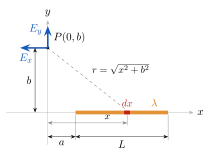

# Ejercicio 5

## Enunciado

Considere la varilla delgada con densidad de carga lineal uniforme $\lambda$ situada sobre el eje $x$, entre $x=a$ y $x=a+L$. El punto $P$ se localiza en $(0,b)$.

a) Determine el potencial eléctrico en el punto $P$ mediante integración directa.
b) A partir del potencial obtenido, calcule el campo eléctrico y analice su coherencia física.

## Solución

> **Fórmulas:** $v=\displaystyle\int\frac{{K_e}\,dq}{r}$,  $dq=\lambda\,dx$ ;   $\displaystyle\int\frac{dx}{\sqrt{x^2+b^2}}=\ln\!\left(x+\sqrt{x^2+b^2}\right)$ 
>
> $E_x=-\dfrac{\partial v}{\partial x}$,  $E_y=-\dfrac{\partial v}{\partial y}$

### a) Potencial en $P$

$$
V_P=\int_a^{a+L}\frac{{K_e}\lambda\,dx}{\sqrt{x^2+b^2}}={K_e}\lambda\Big[\ln\!\left(x+\sqrt{x^2+b^2}\right)\Big]_a^{a+L}
\ \Rightarrow\ \boxed{V_P={K_e}\lambda\,\ln\frac{a+L+\sqrt{(a+L)^2+b^2}}{a+\sqrt{a^2+b^2}}}
$$

### b) Campo en $P$

Para derivar se toma $P$ genérico en $(x_P,y)$. Con $u=x-x_P$ ($du=dx$):

$$
V(x_P,y)={K_e}\lambda\Big[\ln\!\left(u+\sqrt{u^2+y^2}\right)\Big]_{u_1}^{u_2},\qquad u_1=a-x_P,\quad u_2=a+L-x_P .
$$

Derivadas de $f=\ln\!\left(u+\sqrt{u^2+y^2}\right)$ (cadena; en la 2.ª se multiplica arriba y abajo por $\sqrt{u^2+y^2}-u$):

$$
\frac{\partial f}{\partial u}=\frac{1+\frac{u}{\sqrt{u^2+y^2}}}{u+\sqrt{u^2+y^2}}=\frac{1}{\sqrt{u^2+y^2}},
\qquad
\frac{\partial f}{\partial y}=\frac{\frac{y}{\sqrt{u^2+y^2}}}{u+\sqrt{u^2+y^2}}=\frac1y\left(1-\frac{u}{\sqrt{u^2+y^2}}\right)
$$

**Componente $x$** ($\partial u/\partial x_P=-1$):

$$
E_x=-\frac{\partial V}{\partial x_P}=-{K_e}\lambda\left[-\frac1{\sqrt{u_2^2+y^2}}+\frac1{\sqrt{u_1^2+y^2}}\right]
\quad\text{en }(0,b):
$$

$$
\boxed{E_x={K_e}\lambda\left[\frac{1}{\sqrt{(a+L)^2+b^2}}-\frac{1}{\sqrt{a^2+b^2}}\right]}
$$

**Componente $y$:**

$$
E_y=-\frac{\partial V}{\partial y}=-\frac{{K_e}\lambda}{y}\left[\left(1-\frac{u_2}{\sqrt{u_2^2+y^2}}\right)-\left(1-\frac{u_1}{\sqrt{u_1^2+y^2}}\right)\right]
\quad\text{en }(0,b):
$$

$$
\boxed{E_y=\frac{{K_e}\lambda}{b}\left[\frac{a+L}{\sqrt{(a+L)^2+b^2}}-\frac{a}{\sqrt{a^2+b^2}}\right]}
$$

**Coherencia física:** $E_x<0$ (apunta a $-x$) y $E_y>0$ (apunta a $+y$): el campo se aleja de la varilla positiva. ✓  Unidades: $[{K_e}\lambda/b]=\mathrm{N/C}$. ✓
