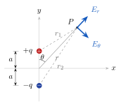

# Ejercicio 7

## Enunciado

Un dipolo eléctrico se ubica a lo largo del eje $y$, como se muestra en la figura. La magnitud del momento dipolar es $p=2qa$.

a) Demuestre que el potencial eléctrico está dado por $V=\dfrac{k_e\,p\cos\theta}{r^2}$.
b) Determine las componentes $E_r$ y $E_\theta$ del campo eléctrico.
c) Exprese $V$, $E_x$ y $E_y$ en coordenadas cartesianas para $r\gg a$.

## Solución

> **De dónde salen las fórmulas del anexo**
> 
> 
- **Ley de cosenos:** es Pitágoras para cualquier triángulo, donde $\gamma$ es el ángulo entre los lados $a$ y $b$. Si $\gamma=90^\circ$, $\cos\gamma=0$ y queda Pitágoras. Para $r_2$ el ángulo es $180^\circ-\theta$, y como $\cos(180^\circ-\theta)=-\cos\theta$, cambia el signo.
> 
- **Binomial:** sale de la recta tangente (Taylor) de $(1+\varepsilon)^n$ en $\varepsilon=0$: vale $1$ y su pendiente es $n$. Ejemplo: $\sqrt{1.01}\approx1+\tfrac12(0.01)=1.005$; el valor exacto es $1.00499$.
> 
- **Polares:** como $\theta$ se mide desde el eje $y$, en el triángulo rectángulo queda $y=r\cos\theta$ y $x=r\sin\theta$.
> 

> **Fórmulas:** $v=\displaystyle\sum\frac{{K_e} q_i}{r_i}$ ;  $E_r=-\dfrac{\partial v}{\partial r}$,  $E_\theta=-\dfrac1r\dfrac{\partial v}{\partial\theta}$ ;  $E_x=-\dfrac{\partial v}{\partial x}$,  $E_y=-\dfrac{\partial v}{\partial y}$ 
>
> **Anexo:**  cosenos $c^2=a^2+b^2-2ab\cos\gamma$ ;  binomial $(1+\varepsilon)^n\approx1+n\varepsilon$  ($|\varepsilon|\ll1$) ;  $\cos\theta=\dfrac yr$,  $r=\sqrt{x^2+y^2}$

### a) Potencial

Cosenos:  $r_1^2=r^2+a^2-2ar\cos\theta$,   $r_2^2=r^2+a^2+2ar\cos\theta$. \
Para $r\gg a$ se desprecia $a^2/r^2$:

$$
\frac1{r_1}=\frac1r\Big(1-\tfrac{2a}{r}\cos\theta\Big)^{-1/2}\approx\frac1r\Big(1+\tfrac{a}{r}\cos\theta\Big),
\qquad
\frac1{r_2}\approx\frac1r\Big(1-\tfrac{a}{r}\cos\theta\Big)
\quad(\text{binomial, } n=-\tfrac12)
$$

$$
V=\frac{{K_e} q}{r_1}-\frac{{K_e} q}{r_2}\approx\frac{{K_e} q}{r}\left[\frac{2a\cos\theta}{r}\right]=\frac{{K_e}(2qa)\cos\theta}{r^2}
\ \Rightarrow\ \boxed{V=\frac{{K_e}\,p\cos\theta}{r^2}}\quad(r\gg a)
$$

### b) Componentes polares

$$
E_r=-\frac{\partial}{\partial r}\left({K_e} p\cos\theta\,r^{-2}\right)=-{K_e} p\cos\theta\,(-2r^{-3})\Rightarrow\boxed{E_r=\frac{2{K_e} p\cos\theta}{r^3}}
$$

$$
E_\theta=-\frac1r\frac{\partial}{\partial\theta}\left(\frac{{K_e} p\cos\theta}{r^2}\right)=-\frac1r\cdot\frac{{K_e} p(-\sin\theta)}{r^2}\Rightarrow\boxed{E_\theta=\frac{{K_e} p\sin\theta}{r^3}}
$$

### c) Cartesianas ($r\gg a$)

$\cos\theta=\dfrac yr$  $\Rightarrow$  $\boxed{V=\dfrac{{K_e} p\,y}{(x^2+y^2)^{3/2}}}$

$$
E_x=-\frac{\partial V}{\partial x}=-{K_e} p\,y\left(-\tfrac32\right)(x^2+y^2)^{-5/2}(2x)\Rightarrow\boxed{E_x=\frac{3{K_e} p\,xy}{(x^2+y^2)^{5/2}}}
$$

$$
E_y=-\frac{\partial V}{\partial y}=-{K_e} p\left[(x^2+y^2)^{-3/2}+y\left(-\tfrac32\right)(x^2+y^2)^{-5/2}(2y)\right]=-{K_e} p\,\frac{(x^2+y^2)-3y^2}{(x^2+y^2)^{5/2}}
$$

$$
\boxed{E_y=\frac{{K_e} p\,(2y^2-x^2)}{(x^2+y^2)^{5/2}}}
$$

**Comprobación:** en el eje $y$ ($x=0$) queda $E_y=\dfrac{2{K_e} p}{y^3}$, que es igual a $E_r$ con $\theta=0$. ✓
