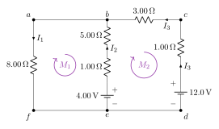

<!-- Sección: Leyes de Kirchhoff -->
# Ejercicio 14

## Enunciado

Determine la corriente, el voltaje y la potencia disipada en cada una de las resistencias del circuito mostrado en la figura. Asimismo, determine la potencia entregada o absorbida por cada una de las fuentes. Analice los resultados con base en los principios de conservación de la energía y de la carga eléctrica.

## Solución

Nodos: $b$ (une $a$–$b$) y $e$ (une $d$–$e$–$f$). Sentidos supuestos: $I_1$ baja por $8\,\Omega$; $I_2$ sube por la rama central; $I_3$ sube por la derecha y va de $c$ a $b$ por $3\,\Omega$. Mallas en sentido horario.

> **Fórmulas:** Nodos: $\sum I_{entra}=\sum I_{sale}$ ;  Mallas: $\sum V=0$ ;  $R$ con $I$: $-IR$, contra $I$: $+IR$ ; fuente $-\to+$: $+\varepsilon$,  $+\to-$: $-\varepsilon$ ;  $P=I^2R$ ;  $P=\varepsilon I$
>
> Ecuaciones: $(\text{nodos}-1)=1$ de nodo y $2$ de malla para las 3 corrientes.

### Sistema de ecuaciones

$$
\text{Nodo } b: \quad I_2+I_3=I_1 \tag{1}
$$
$$
\text{Malla 1 } (f\to a\to b\to e\to f): \quad +8.00I_1+5.00I_2+1.00I_2-4.00=0\ \Rightarrow\ 8I_1+6I_2=4 \tag{2}
$$
$$
\text{Malla 2 } (b\to c\to d\to e\to b): \quad +3.00I_3+1.00I_3-12.0+4.00-1.00I_2-5.00I_2=0
$$
$$
\quad \Rightarrow\ 4I_3-6I_2=8 \tag{3}
$$

### Solución

De (2): $I_1=\dfrac{4-6I_2}{8}$;   de (3): $I_3=\dfrac{8+6I_2}{4}$. Sustituyendo en (1) y multiplicando por 8:

$$
8I_2+2(8+6I_2)=4-6I_2\ \Rightarrow\ 8I_2+16+12I_2+6I_2=4\ \Rightarrow\ 26I_2=-12
$$

$$
\boxed{I_2=-0.462\,\mathrm{A}}\qquad \boxed{I_1=\frac{4-6(-0.4615)}{8}=0.846\,\mathrm{A}}\qquad \boxed{I_3=\frac{8+6(-0.4615)}{4}=1.31\,\mathrm{A}}
$$

$I_2<0$: en la rama central la corriente realmente **baja** ($0.462\,\mathrm{A}$).

| Elemento | $I$ (A) | $V$ (V) | $P$ (W) |
|---|---|---|---|
| $8.00\,\Omega$ | $0.846$ | $6.77$ | $5.73$ |
| $5.00\,\Omega$ | $0.462$ | $2.31$ | $1.07$ |
| $1.00\,\Omega$ (central) | $0.462$ | $0.462$ | $0.213$ |
| $3.00\,\Omega$ | $1.31$ | $3.92$ | $5.13$ |
| $1.00\,\Omega$ (derecha) | $1.31$ | $1.31$ | $1.71$ |
| **Total disipado** |  |  | $\mathbf{13.8}$ |
| Fuente $12.0\,\mathrm{V}$: $I$ sale por $+$ $\Rightarrow$ **entrega** | $1.31$ | $12.0$ | $15.7$ |
| Fuente $4.00\,\mathrm{V}$: $I$ entra por $+$ $\Rightarrow$ **absorbe** | $0.462$ | $4.00$ | $1.85$ |

**Carga:** en el nodo $b$, $I_3=1.31\,\mathrm{A}$ se reparte en $I_1=0.846$ y $0.462\,\mathrm{A}$ (que baja por el centro). ✓  
**Energía:** entregada $15.7\,\mathrm{W}$ $=$ disipada $13.8\,\mathrm{W}$ $+$ absorbida $1.85\,\mathrm{W}$. ✓
