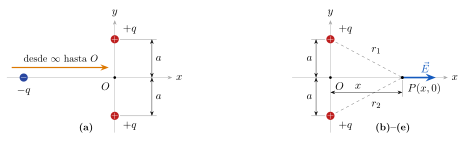
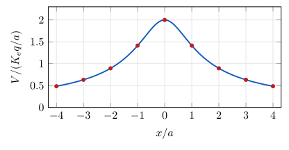

<!-- Sección: Potencial eléctrico -->
# Ejercicio 1

## Enunciado

Dos cargas puntuales positivas, cada una con magnitud $q$, se encuentran fijas sobre el eje $y$ en los puntos $y=+a$ y $y=-a$. Considere el potencial igual a cero a una distancia infinita de las cargas.

a) ¿Cuál es el potencial $V_0$ en el origen? Encuentre el cambio en energía potencial del sistema de dos cargas más una tercera carga $-q$ conforme la última carga se mueve del infinito al origen.
b) Demuestre que el potencial en cualquier punto sobre el eje $x$ es $V(x)=\dfrac{1}{4\pi\varepsilon_0}\dfrac{2q}{\sqrt{a^2+x^2}}$.
c) Con base en la solución del inciso anterior, determine el campo eléctrico sobre el eje $x$.
d) Elabore la gráfica del potencial sobre el eje $x$ como función de $x$ en el intervalo $x=-4a$ a $x=+4a$.
e) ¿Cuál es el potencial y el campo eléctrico cuando $x\gg a$? Explique por qué se obtiene este resultado.

## Solución

**Fórmulas:** 
$V=\sum\dfrac{{K_e} q_i}{r_i}$ ; 
$\Delta U=q\,\Delta V$ ; 
$E_x=-\dfrac{\partial V}{\partial x}$ ; 
$x\gg a:\ V\approx\dfrac{2{K_e} q}{|x|}$ ; 
${K_e}=\dfrac{1}{4\pi\varepsilon_0}$

### a) Potencial en $O$ y $\Delta U$

$r_1=r_2=a$:
  $V_0=\dfrac{{K_e} q}{a}+\dfrac{{K_e} q}{a}\ \Rightarrow\ \boxed{V_0=\dfrac{2{K_e} q}{a}}$

$\Delta U=q_3\,(V_0-V_\infty)=(-q)\left(\dfrac{2{K_e} q}{a}-0\right)\ \Rightarrow\ \boxed{\Delta U=-\dfrac{2{K_e} q^2}{a}}$
  (negativo: $-q$ es atraída)

### b) Potencial sobre el eje $x$

$r_1=r_2=\sqrt{x^2+a^2}$:
  $V(x)=\dfrac{{K_e} q}{\sqrt{a^2+x^2}}+\dfrac{{K_e} q}{\sqrt{a^2+x^2}}
=\boxed{\dfrac{1}{4\pi\varepsilon_0}\dfrac{2q}{\sqrt{a^2+x^2}}}$  \checkmark

### c) Campo sobre el eje $x$

$V=2{K_e} q\,(a^2+x^2)^{-1/2}$
  $\dfrac{dV}{dx}=2{K_e} q\left(-\tfrac12\right)(a^2+x^2)^{-3/2}(2x)=-\dfrac{2{K_e} q\,x}{(a^2+x^2)^{3/2}}$

$E_x=-\dfrac{dV}{dx}$,  $E_y=0$ (las componentes $y$ de las dos cargas se cancelan):
  $\boxed{\vec E=\dfrac{2{K_e} q\,x}{(a^2+x^2)^{3/2}}\,\hat\imath}$

Se aleja del origen ($+\hat\imath$ si $x>0$, $-\hat\imath$ si $x<0$) y $\vec E=0$ en $x=0$.

### d) Gráfica de $V(x)$

$V=\dfrac{{K_e} q}{a}\cdot\dfrac{2}{\sqrt{1+(x/a)^2}}$

| $x/a$ | $0$ | $\pm1$ | $\pm2$ | $\pm3$ | $\pm4$ |
|---|---|---|---|---|---|
| $\dfrac{V}{{K_e} q/a}$ | $2$ | $1.41$ | $0.89$ | $0.63$ | $0.49$ |

Máximo en $x=0$ ($=V_0$), par, siempre positiva.

### e) Para $x\gg a$

$\sqrt{a^2+x^2}\approx|x|$:
  $\boxed{V\approx\dfrac{2{K_e} q}{|x|}}$  $\boxed{|\vec E|\approx\dfrac{2{K_e} q}{x^2}}$  (alejándose del origen)

Desde lejos la separación $2a$ no se nota: el sistema se ve como **una sola carga puntual $2q$** en el origen.
