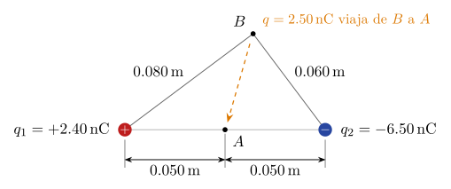

# Ejercicio 2

## Enunciado

Dos cargas puntuales $q_1=+2.40\,\mathrm{nC}$ y $q_2=-6.50\,\mathrm{nC}$ están separadas $0.100\,\mathrm{m}$. El punto $A$ está a la mitad de la distancia entre ellas; el punto $B$ está a $0.080\,\mathrm{m}$ de $q_1$ y $0.060\,\mathrm{m}$ de $q_2$ (ver figura). Considere el potencial eléctrico como cero en el infinito. Determine:

a) el potencial en el punto $A$;
b) el potencial en el punto $B$;
c) el trabajo realizado por el campo eléctrico sobre una carga de $2.50\,\mathrm{nC}$ que viaja del punto $B$ al punto $A$.

## Solución

> **Fórmulas:** $V=\displaystyle\sum_i\frac{{K_e} q_i}{r_i}$ ;   $W_{B\to A}=q\,(V_B-V_A)$ ;   ${K_e}=9\times10^9\,\mathrm{N\,m^2/C^2}$

**Datos SI:** $q_1=2.40\,\mathrm{nC}=2.40\times10^{-9}\,\mathrm{C}$;  $q_2=-6.50\,\mathrm{nC}=-6.50\times10^{-9}\,\mathrm{C}$;  $q=2.50\,\mathrm{nC}=2.50\times10^{-9}\,\mathrm{C}$.

### a) Potencial en $A$  ($r_{1A}=r_{2A}=0.050\,\mathrm{m}$)

$$
V_A=\frac{{K_e} q_1}{r_{1A}}+\frac{{K_e} q_2}{r_{2A}}=\frac{{K_e}\,(q_1+q_2)}{r_{1A}}
=\frac{(9\times10^9)\cdot(2.40\times10^{-9}-6.50\times10^{-9})}{0.050}
$$

$$
V_A=\frac{(9\times10^9)\cdot(-4.10\times10^{-9})}{0.050}=\frac{-36.9}{0.050}
\ \Rightarrow\ \boxed{V_A=-738\,\mathrm{V}}
$$

### b) Potencial en $B$  ($r_{1B}=0.080\,\mathrm{m}$,  $r_{2B}=0.060\,\mathrm{m}$)

$$
V_B={K_e}\left(\frac{q_1}{r_{1B}}+\frac{q_2}{r_{2B}}\right)
=(9\times10^9)\cdot\left(\frac{2.40\times10^{-9}}{0.080}-\frac{6.50\times10^{-9}}{0.060}\right)
$$

$$
V_B=(9\times10^9)\cdot\left(3.00\times10^{-8}-1.083\times10^{-7}\right)=(9\times10^9)\cdot(-7.833\times10^{-8})\ \Rightarrow\ \boxed{V_B=-705\,\mathrm{V}}
$$

### c) Trabajo del campo sobre $q$ de $B$ a $A$

$$
W_{B\to A}=q\,(V_B-V_A)=(2.50\times10^{-9})\cdot\big[-705-(-738)\big]=(2.50\times10^{-9})\cdot(33.0)
$$

$$
\boxed{W_{B\to A}=8.25\times10^{-8}\,\mathrm{J}}
$$

Positivo: la carga positiva va de mayor potencial ($-705\,\mathrm{V}$) a menor ($-738\,\mathrm{V}$), así que el campo la empuja en el sentido del movimiento.
