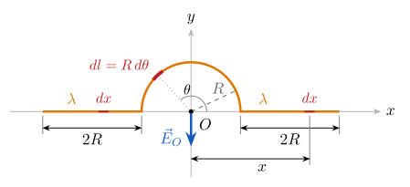

# Ejercicio 3

## Enunciado

Un alambre con una densidad de carga lineal uniforme $\lambda$ se dobla como se muestra en la figura (dos tramos rectos de longitud $2R$ y un semicírculo de radio $R$ centrado en $O$).

a) Determine el potencial eléctrico en el punto $O$.
b) Determine el campo eléctrico en el punto $O$.

## Solución

$O$ es el origen y el centro del semicírculo. Tramo derecho: $R\le x\le3R$; tramo izquierdo: $-3R\le x\le-R$; arco: $0\le\theta\le\pi$.

> **Fórmulas:** $V=\displaystyle\int\frac{{K_e}\,dq}{r}$,  $dq=\lambda\,dl$ ;   carga puntual: $V=\dfrac{{K_e} q}{r}$ ;   $E_r=-\dfrac{\partial V}{\partial r}$ ;   recto: $\displaystyle\int\frac{{K_e}\lambda\,dx}{x}={K_e}\lambda\ln x$ ;   arco: $V={K_e}\lambda\dfrac{L_{arco}}{R}$

### a) Potencial en $O$

**Paso 1. Superposición.**  El alambre se divide en tres partes y se suman sus potenciales:

$$
V_O=V_{izq}+V_{arco}+V_{der}
\tag{1}
$$

**Paso 2. Tramo derecho.**  Un pedacito en la posición $x$ mide $dx$, tiene carga $dq=\lambda\,dx$ y está a una distancia $r=x$ de $O$:

$$
dV_{der}=\frac{{K_e}\,dq}{r}=\frac{{K_e}\lambda\,dx}{x}
$$

Se integra de $x=R$ a $x=3R$. ${K_e}$ y $\lambda$ son constantes y salen de la integral:

$$
V_{der}=\int_R^{3R}\frac{{K_e}\lambda\,dx}{x}={K_e}\lambda\int_R^{3R}\frac{dx}{x}={K_e}\lambda\Big[\ln x\Big]_R^{3R}={K_e}\lambda\big(\ln(3R)-\ln R\big)
$$

Con la propiedad $\ln A-\ln B=\ln\dfrac AB$:

$$
V_{der}={K_e}\lambda\ln\frac{3R}{R}={K_e}\lambda\ln3
\tag{2}
$$

**Paso 3. Tramo izquierdo.**  Ahora $x$ es negativo ($-3R\le x\le-R$) y la distancia es $r=|x|=-x$:

$$
V_{izq}=\int_{-3R}^{-R}\frac{{K_e}\lambda\,dx}{-x}
$$

Cambio de variable $u=-x$, $\;du=-dx\;\Rightarrow\;dx=-du$. Límites: $x=-3R\to u=3R$;  $x=-R\to u=R$.

$$
V_{izq}=\int_{3R}^{R}\frac{{K_e}\lambda\,(-du)}{u}={K_e}\lambda\int_{R}^{3R}\frac{du}{u}={K_e}\lambda\Big[\ln u\Big]_R^{3R}={K_e}\lambda\ln\frac{3R}{R}
$$

(el signo $-$ se usó para invertir los límites).

$$
V_{izq}={K_e}\lambda\ln3
\tag{3}
$$

**Paso 4. Semicírculo.**  Un pedacito del arco en el ángulo $\theta$ mide $dl=R\,d\theta$, tiene carga $dq=\lambda R\,d\theta$ y está a distancia $r=R$ de $O$. Todo el arco está a la misma distancia:

$$
V_{arco}=\int_0^{\pi}\frac{{K_e}\,\lambda R\,d\theta}{R}={K_e}\lambda\int_0^{\pi}d\theta={K_e}\lambda\Big[\theta\Big]_0^{\pi}={K_e}\lambda(\pi-0)
$$

$$
V_{arco}=\pi{K_e}\lambda
\tag{4}
$$

Coincide con la fórmula de la hoja: ${K_e}\lambda\dfrac{L_{arco}}{R}={K_e}\lambda\dfrac{\pi R}{R}=\pi{K_e}\lambda$.

**Paso 5. Suma.**  Se reemplazan (2), (3) y (4) en (1):

$$
V_O={K_e}\lambda\ln3+\pi{K_e}\lambda+{K_e}\lambda\ln3={K_e}\lambda\,(\pi+2\ln3)
$$

Valor numérico del paréntesis: $\pi+2\ln3=3.1416+2\times1.0986=3.1416+2.1972=5.3388$.

$$
\boxed{V_O={K_e}\lambda\,(\pi+2\ln3)\approx5.34\,{K_e}\lambda=\frac{\lambda\,(\pi+2\ln3)}{4\pi\varepsilon_0}}
$$

### b) Campo eléctrico en $O$

El campo no se puede sacar derivando $V_O$, porque es un solo número: para derivar haría falta $V$ en puntos alrededor de $O$. Por eso se suma el campo de cada pedacito.

**Paso 1. Campo de un pedacito**  (sale de las fórmulas de la hoja). Para una carga puntual $V={K_e} q\,r^{-1}$:

$$
E_r=-\frac{\partial V}{\partial r}=-{K_e} q\left(-1\cdot r^{-2}\right)=\frac{{K_e} q}{r^2}
\qquad\Rightarrow\qquad dE=\frac{{K_e}\,dq}{r^2}
$$

Con $\lambda>0$, cada $d\vec E$ apunta desde el pedacito hacia $O$ y sigue de largo (se aleja de la carga).

**Paso 2. Tramo derecho.**  El pedacito está en $(x,0)$ con $x>0$; su campo en $O$ apunta hacia $-x$:

$$
E_{der}=\int_R^{3R}\frac{{K_e}\lambda\,dx}{x^2}={K_e}\lambda\int_R^{3R}x^{-2}\,dx={K_e}\lambda\left[\frac{x^{-1}}{-1}\right]_R^{3R}={K_e}\lambda\left[-\frac1x\right]_R^{3R}
={K_e}\lambda\left(-\frac{1}{3R}+\frac1R\right)
$$

$$
E_{der}={K_e}\lambda\left(\frac{-1+3}{3R}\right)=\frac{2{K_e}\lambda}{3R}
\qquad\Rightarrow\qquad
\vec E_{der}=-\frac{2{K_e}\lambda}{3R}\,\hat\imath
$$

**Paso 3. Tramo izquierdo.**  El pedacito está en $(x,0)$ con $x<0$, a distancia $|x|$ ($|x|^2=x^2$); su campo en $O$ apunta hacia $+x$:

$$
E_{izq}=\int_{-3R}^{-R}\frac{{K_e}\lambda\,dx}{x^2}={K_e}\lambda\left[-\frac1x\right]_{-3R}^{-R}
={K_e}\lambda\left[\left(-\frac{1}{-R}\right)-\left(-\frac{1}{-3R}\right)\right]={K_e}\lambda\left(\frac1R-\frac1{3R}\right)=\frac{2{K_e}\lambda}{3R}
$$

$$
\vec E_{izq}=+\frac{2{K_e}\lambda}{3R}\,\hat\imath
\qquad\Rightarrow\qquad
\vec E_{izq}+\vec E_{der}=\frac{2{K_e}\lambda}{3R}\,\hat\imath-\frac{2{K_e}\lambda}{3R}\,\hat\imath=\vec 0
$$

Los dos tramos rectos se anulan (son iguales y están a lados opuestos de $O$).

**Paso 4. Semicírculo.**  El pedacito está en $(R\cos\theta,\,R\sin\theta)$ con $dq=\lambda R\,d\theta$ y $r=R$:

$$
dE=\frac{{K_e}\,\lambda R\,d\theta}{R^2}=\frac{{K_e}\lambda}{R}\,d\theta
$$

Desde el pedacito hacia $O$ la dirección es $(-\cos\theta,\,-\sin\theta)$. Las componentes son:

$$
dE_x=-\frac{{K_e}\lambda}{R}\cos\theta\,d\theta,\qquad dE_y=-\frac{{K_e}\lambda}{R}\sin\theta\,d\theta
$$

Se integra cada componente de $\theta=0$ a $\theta=\pi$:

$$
E_x=-\frac{{K_e}\lambda}{R}\int_0^{\pi}\cos\theta\,d\theta=-\frac{{K_e}\lambda}{R}\Big[\sin\theta\Big]_0^{\pi}=-\frac{{K_e}\lambda}{R}\,(\sin\pi-\sin0)=-\frac{{K_e}\lambda}{R}(0-0)=0
$$

$$
E_y=-\frac{{K_e}\lambda}{R}\int_0^{\pi}\sin\theta\,d\theta=-\frac{{K_e}\lambda}{R}\Big[-\cos\theta\Big]_0^{\pi}=-\frac{{K_e}\lambda}{R}\,(-\cos\pi+\cos0)=-\frac{{K_e}\lambda}{R}\,(1+1)=-\frac{2{K_e}\lambda}{R}
$$

Coincide con la fórmula de la hoja para el semicírculo: $E=\dfrac{2{K_e}\lambda}{R}$.

**Paso 5. Suma.** 

$$
\vec E_O=\underbrace{\vec E_{izq}+\vec E_{der}}_{\vec 0}+\vec E_{arco}
\qquad\Rightarrow\qquad
\boxed{\vec E_O=-\frac{2{K_e}\lambda}{R}\,\hat\jmath=-\frac{\lambda}{2\pi\varepsilon_0R}\,\hat\jmath}
$$

El campo apunta hacia abajo ($-y$), alejándose del arco, que tiene carga positiva y está arriba de $O$.

**Unidades:** $[{K_e}\lambda]=\dfrac{\mathrm{N\,m^2}}{\mathrm{C^2}}\cdot\dfrac{\mathrm C}{\mathrm m}=\dfrac{\mathrm{N\,m}}{\mathrm C}=\mathrm V$ ✓  
$\left[\dfrac{{K_e}\lambda}{R}\right]=\dfrac{\mathrm V}{\mathrm m}=\dfrac{\mathrm N}{\mathrm C}$ ✓
