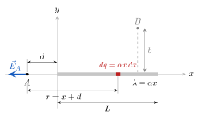

# Ejercicio 4

## Enunciado

Una varilla de longitud $L$ yace a lo largo del eje $x$, con su extremo izquierdo en el origen. Además, tiene una densidad de carga no uniforme $\lambda=\alpha x$, donde $\alpha$ es una constante positiva. El punto $A$ está sobre el eje $x$, a una distancia $d$ a la izquierda del origen.

a) ¿Cuáles son las unidades de $\alpha$?
b) Calcule el potencial eléctrico en el punto $A$.
c) A partir del potencial obtenido, calcule el campo eléctrico y analice su coherencia física.

## Solución

$A$ está sobre el eje $x$, en $x_A=-d$. El punto $B$ aparece en la figura original, pero no se pregunta por él.

> **Fórmulas:** $V=\displaystyle\int\frac{{K_e}\,dq}{r}$,  $dq=\lambda\,dx$ ;   $\displaystyle\int\frac{du}{u}=\ln u$ ;   $E_x=-\dfrac{\partial V}{\partial x}$ ;   $\ln A-\ln B=\ln\dfrac AB$

### a) Unidades de $\alpha$

$\lambda$ es carga por unidad de longitud: $[\lambda]=\mathrm{C/m}$. Despejando $\alpha$ de $\lambda=\alpha x$:

$$
\alpha=\frac{\lambda}{x}\qquad\Rightarrow\qquad[\alpha]=\frac{[\lambda]}{[x]}=\frac{\mathrm{C/m}}{\mathrm m}
\qquad\Rightarrow\qquad\boxed{[\alpha]=\mathrm{C/m^2}}
$$

### b) Potencial en $A$

**Paso 1. Elemento de carga.**  Un pedacito de varilla en la posición $x$ ($0\le x\le L$) mide $dx$ y tiene carga

$$
dq=\lambda\,dx=\alpha x\,dx
$$

**Paso 2. Distancia a $A$.**  $A$ está en $x_A=-d$, así que

$$
r=x-x_A=x-(-d)=x+d
$$

**Paso 3. Plantear la integral.** 

$$
V_A=\int_0^L\frac{{K_e}\,dq}{r}=\int_0^L\frac{{K_e}\,\alpha x\,dx}{x+d}={K_e}\alpha\int_0^L\frac{x}{x+d}\,dx
\tag{1}
$$

**Paso 4. Arreglo algebraico.**  Se suma y se resta $d$ en el numerador para separar la fracción:

$$
\frac{x}{x+d}=\frac{(x+d)-d}{x+d}=\frac{x+d}{x+d}-\frac{d}{x+d}=1-\frac{d}{x+d}
$$

Entonces

$$
\int_0^L\frac{x}{x+d}\,dx=\int_0^L dx-d\int_0^L\frac{dx}{x+d}
$$

**Paso 5. Primera integral.**  $\displaystyle\int_0^L dx=\Big[x\Big]_0^L=L-0=L$.

**Paso 6. Segunda integral.**  Cambio de variable $u=x+d$, $\;du=dx$. Límites: $x=0\to u=d$;  $x=L\to u=L+d$.

$$
\int_0^L\frac{dx}{x+d}=\int_d^{L+d}\frac{du}{u}=\Big[\ln u\Big]_d^{L+d}=\ln(L+d)-\ln d=\ln\frac{L+d}{d}=\ln\!\left(1+\frac Ld\right)
$$

**Paso 7. Resultado.**  Se reemplazan los pasos 5 y 6 en (1):

$$
\boxed{V_A={K_e}\alpha\left[L-d\ln\!\left(1+\frac Ld\right)\right]=\frac{\alpha}{4\pi\varepsilon_0}\left[L-d\ln\!\left(1+\frac Ld\right)\right]}
\tag{2}
$$

### c) Campo eléctrico en $A$ a partir del potencial

**Paso 1. Variable correcta.**  $E_x=-\dfrac{\partial V}{\partial x}$ pide derivar respecto a la posición del punto, $x_A$. Como $x_A=-d$:

$$
d=-x_A\qquad\Rightarrow\qquad\frac{\partial d}{\partial x_A}=-1
$$

Por la regla de la cadena:

$$
E_x=-\frac{\partial V}{\partial x_A}=-\frac{dV}{dd}\cdot\frac{\partial d}{\partial x_A}=-\frac{dV}{dd}\cdot(-1)=\frac{dV}{dd}
\tag{3}
$$

**Paso 2. Reescribir $V$.**  Con $\ln\dfrac{L+d}{d}=\ln(L+d)-\ln d$:

$$
V={K_e}\alpha\Big[L-d\ln(L+d)+d\ln d\Big]
$$

**Paso 3. Derivar término por término**  respecto a $d$ ($L$ es constante):

- $\dfrac{d}{dd}(L)=0$

- Regla del producto: $\dfrac{d}{dd}\big[d\ln(L+d)\big]=(1)\ln(L+d)+d\cdot\dfrac{1}{L+d}=\ln(L+d)+\dfrac{d}{L+d}$

- Regla del producto: $\dfrac{d}{dd}\big[d\ln d\big]=(1)\ln d+d\cdot\dfrac1d=\ln d+1$

$$
\frac{dV}{dd}={K_e}\alpha\left[0-\ln(L+d)-\frac{d}{L+d}+\ln d+1\right]
$$

**Paso 4. Simplificar.**  Se agrupan los logaritmos, $-\ln(L+d)+\ln d=-\ln\dfrac{L+d}{d}=-\ln\!\left(1+\dfrac Ld\right)$, y los otros términos:

$$
1-\frac{d}{L+d}=\frac{(L+d)-d}{L+d}=\frac{L}{L+d}
\qquad\Rightarrow\qquad
\frac{dV}{dd}={K_e}\alpha\left[\frac{L}{L+d}-\ln\!\left(1+\frac Ld\right)\right]
$$

**Paso 5. Resultado.**  Por (3):

$$
\boxed{E_x=-{K_e}\alpha\left[\ln\!\left(1+\frac Ld\right)-\frac{L}{L+d}\right]}
\tag{4}
$$

**Paso 6. Componentes $y$ y $z$.**  Todas las cargas y el punto $A$ están sobre el eje $x$, así que cada $d\vec E$ apunta a lo largo de ese eje:  $E_y=E_z=0$.

### Coherencia física

- **Signo.** Sea $u=L/d>0$ y $f(u)=\ln(1+u)-\dfrac{u}{1+u}$, que es el corchete de (4). En $u=0$ vale $f(0)=0-0=0$, y su derivada es

$$
f'(u)=\frac{1}{1+u}-\frac{(1)(1+u)-u(1)}{(1+u)^2}=\frac{1}{1+u}-\frac{1}{(1+u)^2}=\frac{(1+u)-1}{(1+u)^2}=\frac{u}{(1+u)^2}>0 .
$$

Como $f$ arranca en $0$ y siempre crece, $f(u)>0$, y entonces $E_x<0$. El campo apunta hacia $-x$: se aleja de la varilla, que tiene carga positiva ($\alpha>0$). ✓

- **Lejos** ($d\to\infty$): $\ln(1+L/d)\to\ln1=0$ y $\dfrac{L}{L+d}\to0$, así que $E_x\to0$. ✓

- **Unidades:** $[{K_e}\alpha]=\dfrac{\mathrm{N\,m^2}}{\mathrm{C^2}}\cdot\dfrac{\mathrm C}{\mathrm{m^2}}=\dfrac{\mathrm N}{\mathrm C}$ y el corchete no tiene unidades $\Rightarrow$ $[E_x]=\mathrm{N/C}$.  En (2), $[{K_e}\alpha L]=\dfrac{\mathrm N}{\mathrm C}\cdot\mathrm m=\mathrm V$. ✓
