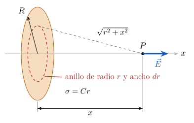

# Ejercicio 6

## Enunciado

Un disco de radio $R$ tiene una densidad de carga superficial no uniforme dada por $\sigma=Cr$. Determine el potencial eléctrico en el punto $P$ (sobre el eje del disco, a una distancia $x$ de su centro) mediante integración directa y, a partir de este, calcule el campo eléctrico.

## Solución

> **Fórmulas:** $V=\displaystyle\int_0^R\frac{{K_e}\,\sigma(r)\,2\pi r\,dr}{\sqrt{r^2+x^2}}$ ;   $\displaystyle\int\frac{dr}{\sqrt{r^2+x^2}}=\ln\!\left(r+\sqrt{r^2+x^2}\right)$ ;   $E_x=-\dfrac{\partial V}{\partial x}$ ;   partes: $\displaystyle\int u\,dv=uv-\int v\,du$

### Potencial en $P$

**Paso 1. Elemento de carga (anillo).**  Un anillo de radio $r$ y ancho $dr$ tiene área $dA=(\text{perímetro})\cdot(\text{ancho})=2\pi r\,dr$, y su carga es

$$
dq=\sigma\,dA=(Cr)(2\pi r\,dr)=2\pi C\,r^2\,dr
$$

**Paso 2. Distancia a $P$.**  Por Pitágoras, todos los puntos del anillo están a la misma distancia de $P$:  $\sqrt{r^2+x^2}$.

**Paso 3. Plantear la integral.**  Se suman los anillos de $r=0$ a $r=R$:

$$
V=\int_0^R\frac{{K_e}\,(2\pi C\,r^2\,dr)}{\sqrt{r^2+x^2}}=2\pi{K_e} C\;I,
\qquad
I=\int_0^R\frac{r^2\,dr}{\sqrt{r^2+x^2}}
\tag{1}
$$

**Paso 4. Integral por partes**  (primero sin límites):

$$
u=r\ \Rightarrow\ du=dr,\qquad\qquad dv=\frac{r\,dr}{\sqrt{r^2+x^2}}\ \Rightarrow\ v=\int\frac{r\,dr}{\sqrt{r^2+x^2}}
$$

Para hallar $v$ se usa la sustitución $w=r^2+x^2$,  $dw=2r\,dr$ $\Rightarrow$ $r\,dr=\dfrac{dw}{2}$:

$$
v=\int\frac{dw/2}{\sqrt w}=\frac12\int w^{-1/2}\,dw=\frac12\cdot\frac{w^{1/2}}{1/2}=\sqrt w=\sqrt{r^2+x^2}
$$

Entonces:

$$
\int\frac{r^2\,dr}{\sqrt{r^2+x^2}}=uv-\int v\,du=r\sqrt{r^2+x^2}-\int\sqrt{r^2+x^2}\,dr
\tag{2}
$$

**Paso 5. La integral que quedó.**  Se multiplica y divide por $\sqrt{r^2+x^2}$ y se separa la fracción:

$$
\int\sqrt{r^2+x^2}\,dr=\int\frac{r^2+x^2}{\sqrt{r^2+x^2}}\,dr=\int\frac{r^2\,dr}{\sqrt{r^2+x^2}}+x^2\int\frac{dr}{\sqrt{r^2+x^2}}
$$

La primera es la misma integral de (2) y la segunda es la fórmula del $\ln$ de la hoja:

$$
\int\sqrt{r^2+x^2}\,dr=\int\frac{r^2\,dr}{\sqrt{r^2+x^2}}+x^2\ln\!\left(r+\sqrt{r^2+x^2}\right)
$$

**Paso 6. Despejar.**  Llamando $J=\displaystyle\int\frac{r^2\,dr}{\sqrt{r^2+x^2}}$ y reemplazando el paso 5 en (2):

$$
J=r\sqrt{r^2+x^2}-J-x^2\ln\!\left(r+\sqrt{r^2+x^2}\right)
\ \Rightarrow\ 2J=r\sqrt{r^2+x^2}-x^2\ln\!\left(r+\sqrt{r^2+x^2}\right)
$$

$$
J=\tfrac12\Big[r\sqrt{r^2+x^2}-x^2\ln\!\left(r+\sqrt{r^2+x^2}\right)\Big]
\tag{3}
$$

**Paso 7. Límites de $0$ a $R$**  (con $x>0$, así que $\sqrt{0+x^2}=x$):

$$
\text{En } r=R:\quad \tfrac12\Big[R\sqrt{R^2+x^2}-x^2\ln\!\left(R+\sqrt{R^2+x^2}\right)\Big]
$$

$$
\text{En } r=0:\quad \tfrac12\Big[0\cdot x-x^2\ln(0+x)\Big]=-\tfrac12\,x^2\ln x
$$

$$
I=\tfrac12\Big[R\sqrt{R^2+x^2}-x^2\ln\!\left(R+\sqrt{R^2+x^2}\right)+x^2\ln x\Big]
=\tfrac12\left[R\sqrt{R^2+x^2}-x^2\ln\frac{R+\sqrt{R^2+x^2}}{x}\right]
$$

**Paso 8. Resultado.**  Se reemplaza en (1); el $2$ se cancela con el $\tfrac12$:

$$
\boxed{V=\pi{K_e} C\left[R\sqrt{R^2+x^2}-x^2\ln\frac{R+\sqrt{R^2+x^2}}{x}\right]}
\tag{4}
$$

### Campo eléctrico en $P$ a partir del potencial

**Paso 1. Notación.**  Sea $s=\sqrt{R^2+x^2}$. Entonces

$$
\frac{ds}{dx}=\frac12\left(R^2+x^2\right)^{-1/2}(2x)=\frac{x}{s},
\qquad\qquad
(R+s)(s-R)=s^2-R^2=(R^2+x^2)-R^2=x^2 .
$$

Se escribe (4) como $V=\pi{K_e} C\,\big[A-B\big]$ con $A=Rs$ y $B=x^2\big[\ln(R+s)-\ln x\big]$.

**Paso 2. Derivada de $A$:**    $\dfrac{dA}{dx}=R\,\dfrac{ds}{dx}=\dfrac{Rx}{s}$.

**Paso 3. Derivada de $B$**  (regla del producto):

$$
\frac{dB}{dx}=2x\Big[\ln(R+s)-\ln x\Big]+x^2\left[\frac{1}{R+s}\cdot\frac{ds}{dx}-\frac1x\right]
=2x\ln\frac{R+s}{x}+\frac{x^2\cdot x}{s\,(R+s)}-x
$$

El término del medio se simplifica multiplicando arriba y abajo por $(s-R)$ y usando $(R+s)(s-R)=x^2$:

$$
\frac{x^3}{s\,(R+s)}=\frac{x^3\,(s-R)}{s\,(R+s)(s-R)}=\frac{x^3\,(s-R)}{s\,x^2}=\frac{x\,(s-R)}{s}=x-\frac{Rx}{s}
$$

$$
\frac{dB}{dx}=2x\ln\frac{R+s}{x}+x-\frac{Rx}{s}-x=2x\ln\frac{R+s}{x}-\frac{Rx}{s}
$$

**Paso 4. Derivada de $V$:** 

$$
\frac{dV}{dx}=\pi{K_e} C\left[\frac{dA}{dx}-\frac{dB}{dx}\right]=\pi{K_e} C\left[\frac{Rx}{s}-2x\ln\frac{R+s}{x}+\frac{Rx}{s}\right]
=2\pi{K_e} C\,x\left[\frac{R}{s}-\ln\frac{R+s}{x}\right]
$$

**Paso 5. Resultado.**  $E_x=-\dfrac{dV}{dx}$ (al cambiar el signo se invierte el orden del corchete):

$$
\boxed{E_x=2\pi{K_e} C\,x\left[\ln\frac{R+\sqrt{R^2+x^2}}{x}-\frac{R}{\sqrt{R^2+x^2}}\right]}\qquad E_y=E_z=0
\tag{5}
$$

$E_y=E_z=0$ porque, por simetría, las componentes perpendiculares al eje de dos puntos opuestos de cada anillo se cancelan.

### Coherencia física

- **Signo.** Sea $g(R)$ el corchete de (5), visto como función de $R$:

$$
g(R)=\ln\frac{R+s}{x}-\frac Rs,\qquad g(0)=\ln\frac{x}{x}-0=0,\qquad \frac{ds}{dR}=\frac Rs .
$$

Derivando respecto a $R$:

$$
\frac{dg}{dR}=\frac{1+\frac Rs}{R+s}-\frac{s-R\cdot\frac Rs}{s^2}=\frac1s-\frac{s^2-R^2}{s^3}=\frac{s^2-x^2}{s^3}=\frac{R^2}{s^3}>0 .
$$

Entonces $g>0$, y si $C>0$, $E_x>0$: el campo se aleja del disco. ✓

- **Unidades:** $[C]=\dfrac{[\sigma]}{[r]}=\dfrac{\mathrm{C/m^2}}{\mathrm m}=\mathrm{C/m^3}$.  $[{K_e} C\,R\,s]=\dfrac{\mathrm{N\,m^2}}{\mathrm{C^2}}\cdot\dfrac{\mathrm C}{\mathrm{m^3}}\cdot\mathrm{m^2}=\dfrac{\mathrm{N\,m}}{\mathrm C}=\mathrm V$ ✓   $[{K_e} C\,x]=\dfrac{\mathrm N}{\mathrm C}$ ✓
