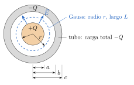
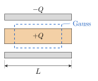
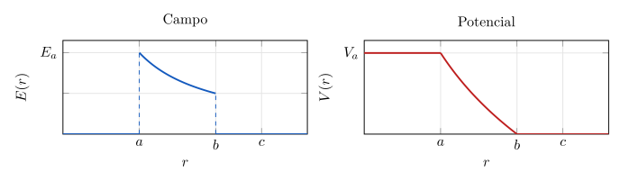

<!-- Sección: Capacitancia -->
# Ejercicio 8

## Enunciado

**Cilindros coaxiales.** Un cilindro metálico largo, de longitud $L$ y radio $a$, está dispuesto coaxialmente con un tubo metálico largo de la misma longitud, con radio interior $b$ y radio exterior $c$ ($a<b<c$). La carga total del cilindro interior es $Q$, mientras que la carga total del cilindro exterior es $-Q$. Se asume que la separación entre el cilindro y el tubo es mucho menor que la longitud de ambos ($b-a\ll L$), por lo que pueden despreciarse los efectos de borde.

a) Usando la Ley de Gauss, determine el campo eléctrico $\vec E(r)$ en las regiones: i) $r<a$, ii) $a<r<b$, iii) $b<r<c$, iv) $r>c$. En el mismo plano, grafique el campo eléctrico en función de $r$.
b) Determine el potencial eléctrico $V(r)$ en cada una de las regiones, especificando claramente el nivel de referencia elegido. En el mismo plano, grafique el potencial en función de $r$.
c) Calcule la capacitancia del sistema y analice su dependencia con los parámetros geométricos.

## Solución

Capacitor coaxial en perspectiva: cilindro interior de radio $a$ y tubo de radios $b$ y $c$, ambos de longitud $L$ ($b-a\ll L$).

Vista transversal: círculos concéntricos de radios $a$, $b$ y $c$, y superficie gaussiana de radio $r$ (punteada).

> **Fórmulas:** Gauss: $\oint\vec E\cdot d\vec A=\dfrac{q_{enc}}{\varepsilon_0}$ ;  $E=0$ dentro del metal ;  $\Delta V=V_b-V_a=-\displaystyle\int_a^b\vec E\cdot d\vec s$,  con $\vec E$ radial: $V_b-V_a=-\displaystyle\int_a^b E\,dr$ ;  $C=\dfrac{Q}{\Delta V}$

### a) Campo eléctrico con la Ley de Gauss

**Paso 1. Superficie gaussiana.**  Un cilindro de radio $r$ y largo $L$, con el mismo eje que los conductores. Por simetría, $\vec E$ es radial y tiene el mismo valor en todos los puntos de la cara lateral.

**Paso 2. Flujo.**  En las dos tapas, $\vec E$ es radial y $d\vec A$ apunta a lo largo del eje; son perpendiculares, así que $\vec E\cdot d\vec A=0$. En la cara lateral, $\vec E$ y $d\vec A$ son paralelos:

$$
\oint\vec E\cdot d\vec A=\underbrace{0}_{\text{tapas}}+E\,A_{lat}=E\,(2\pi rL)
\tag{1}
$$

**Paso 3. Ley de Gauss en cada región.**  Igualando (1) con $q_{enc}/\varepsilon_0$:   $E\,(2\pi rL)=\dfrac{q_{enc}}{\varepsilon_0}$.

- **i) $r<a$.** La superficie queda dentro del metal del cilindro. En un conductor en equilibrio la carga $Q$ está en su superficie ($r=a$), así que $q_{enc}=0$:

$$
E\,(2\pi rL)=0\ \Rightarrow\ \boxed{E=0}
$$

- **ii) $a<r<b$.** La superficie encierra todo el cilindro interior, $q_{enc}=Q$:

$$
E\,(2\pi rL)=\frac{Q}{\varepsilon_0}\ \Rightarrow\ \boxed{E=\frac{Q}{2\pi\varepsilon_0L\,r}}\quad\text{radial hacia afuera}
\tag{2}
$$

- **iii) $b<r<c$.** La superficie queda dentro del metal del tubo, así que $E=0$ y, por Gauss, $q_{enc}=0$:

$$
q_{enc}=Q+q_{(r=b)}=0\ \Rightarrow\ q_{(r=b)}=-Q;\qquad q_{(r=c)}=(-Q)-(-Q)=0
\qquad\Rightarrow\qquad\boxed{E=0}
$$

Es decir, toda la carga $-Q$ del tubo queda en su cara interna ($r=b$) y la cara externa queda neutra.

- **iv) $r>c$.** $q_{enc}=Q+(-Q)=0$:

$$
E\,(2\pi rL)=0\ \Rightarrow\ \boxed{E=0}
$$

### b) Potencial eléctrico  (referencia: $V=0$ en el tubo exterior)

**Paso 1. Nivel de referencia.**  Se elige $V=0$ en el tubo exterior (el conductor con carga $-Q$). Como es un conductor en equilibrio, todo su metal está al mismo potencial: $V(b)=V(c)=0$.

**Paso 2. Relación a usar.**  Entre dos radios $r_1$ y $r_2$:   $V(r_2)-V(r_1)=-\displaystyle\int_{r_1}^{r_2}E\,dr$.  Se parte del tubo ($r=b$ o $r=c$) y se avanza hacia afuera y hacia adentro.

- **iii) $b\le r\le c$:**   dentro del metal $E=0$, así que $V(r)-V(b)=-\displaystyle\int_{b}^{r}0\,dr'=0$  $\Rightarrow$  $\boxed{V(r)=0}$.

- **iv) $r\ge c$:**   $V(r)-V(c)=-\displaystyle\int_{c}^{r}0\,dr'=0$  $\Rightarrow$  $V(r)=V(c)$  $\Rightarrow$  $\boxed{V(r)=0}$.

- **ii) $a\le r\le b$:** se usa el campo (2):

$$
V(r)-V(b)=-\int_b^{r}\frac{Q}{2\pi\varepsilon_0L\,r'}\,dr'=-\frac{Q}{2\pi\varepsilon_0L}\int_b^{r}\frac{dr'}{r'}=-\frac{Q}{2\pi\varepsilon_0L}\Big[\ln r'\Big]_b^{r}=-\frac{Q}{2\pi\varepsilon_0L}\big(\ln r-\ln b\big)
$$

$$
V(r)-0=\frac{Q}{2\pi\varepsilon_0L}\big(\ln b-\ln r\big)
\qquad\Rightarrow\qquad
\boxed{V(r)=\frac{Q}{2\pi\varepsilon_0L}\ln\frac br}
$$

- **i) $r\le a$:**   $V(r)-V(a)=-\displaystyle\int_a^r0\,dr'=0$  $\Rightarrow$  $V(r)=V(a)$. Evaluando la expresión de la región ii en $r=a$:

$$
\boxed{V(r)=V(a)=\frac{Q}{2\pi\varepsilon_0L}\ln\frac ba}\quad\text{(constante)}
\tag{3}
$$

**Continuidad:** en $r=b$, $\ln(b/b)=\ln1=0$, que empalma con $V=0$; en $r=a$ empalma con el valor constante (3). $V$ no salta en ningún radio. ✓

Gráficas cualitativas (dibujadas con $b=2a$, $c=2.6a$):  $E_a=\dfrac{Q}{2\pi\varepsilon_0La}$,  $V_a=\dfrac{Q}{2\pi\varepsilon_0L}\ln\dfrac ba$. $E$ salta en $r=a$ y en $r=b$; $V$ es continuo.

### c) Capacitancia

**Paso 1. Diferencia de potencial entre las placas.**  Basta integrar el campo (2) entre la placa interior ($r=a$, carga $+Q$) y la exterior ($r=b$, carga $-Q$); no se necesita ningún nivel de referencia. De la hoja de fórmulas, $V_b-V_a=-\displaystyle\int_a^b E\,dr$, así que:

$$
V_{ab}=V_a-V_b=\int_a^b E\,dr
\tag{4}
$$

Se reemplaza $E=\dfrac{Q}{2\pi\varepsilon_0L\,r}$ y se sacan las constantes de la integral:

$$
V_{ab}=\int_a^b\frac{Q}{2\pi\varepsilon_0L\,r}\,dr=\frac{Q}{2\pi\varepsilon_0L}\int_a^b\frac{dr}{r}
$$

$$
V_{ab}=\frac{Q}{2\pi\varepsilon_0L}\Big[\ln r\Big]_a^b=\frac{Q}{2\pi\varepsilon_0L}\big(\ln b-\ln a\big)
\qquad\Rightarrow\qquad
\boxed{V_{ab}=\frac{Q}{2\pi\varepsilon_0L}\ln\frac ba}
$$

Como $b>a$, $\ln(b/a)>0$ y $V_{ab}>0$: la placa interior (positiva) está a mayor potencial. Coincide con $V(a)-V(b)$ del inciso b), como debe ser, porque una diferencia de potencial no depende de la referencia.

**Paso 2. Definición de capacitancia.**  Con $\Delta V=V_{ab}$:

$$
C=\frac{Q}{V_{ab}}=\frac{Q}{\dfrac{Q}{2\pi\varepsilon_0L}\ln\dfrac ba}=Q\cdot\frac{2\pi\varepsilon_0L}{Q\,\ln(b/a)}
\qquad\Rightarrow\qquad
\boxed{C=\frac{2\pi\varepsilon_0L}{\ln(b/a)}}
$$

(La $Q$ se cancela: $C$ depende solo de la geometría. Coincide con la fórmula del cilindro de la hoja.)

**Paso 3. Dependencia con la geometría.** 

- $C\propto L$: un cable dos veces más largo tiene el doble de capacitancia. Por unidad de longitud, $C/L=\dfrac{2\pi\varepsilon_0}{\ln(b/a)}$.

- Depende solo del cociente $b/a$, no de cada radio por separado. Si $b/a\to1$ (conductores muy cerca), $\ln(b/a)\to0$ y $C$ crece mucho. Si $b\gg a$, $C$ disminuye, aunque lentamente porque el $\ln$ crece despacio.

- No depende de $c$ (el grosor del tubo) porque dentro del metal $E=0$; tampoco depende de $Q$.

**Unidades:** $[\varepsilon_0L]=\dfrac{\mathrm{C^2}}{\mathrm{N\,m^2}}\cdot\mathrm m=\dfrac{\mathrm{C^2}}{\mathrm{N\,m}}=\dfrac{\mathrm{C^2}}{\mathrm J}=\dfrac{\mathrm C}{\mathrm V}=\mathrm F$ ✓
