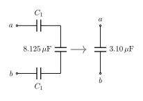

# Ejercicio 10

## Enunciado

En la figura, cada capacitancia $C_1$ es de $10\,\mu\mathrm{F}$ y cada capacitancia $C_2$ es de $5\,\mu\mathrm{F}$.

a) Calcule la capacitancia equivalente de la red entre los puntos $a$ y $b$.
b) Determine la carga y la energía almacenadas en cada uno de los tres capacitores más cercanos a los puntos $a$ y $b$ cuando $V_{ab}=500\,\mathrm{V}$.
c) Con $500\,\mathrm{V}$ aplicados entre los puntos $a$ y $b$, calcule $V_{cd}$ y la energía almacenada en los tres capacitores más alejados de la fuente.

## Solución
**Circuito original**

**Circuito 2** (tres $C_1$ del extremo en serie)

**Circuito 3**

**Circuito 4**

**Circuito 5  y  Circuito 6**

> **Fórmulas:** serie: $\dfrac1{C_{eq}}=\sum\dfrac1{C_i}$ ;  paralelo: $C_{eq}=\sum C_i$ ;  $Q=C\,\Delta V$ ;  $U=\tfrac12Q\,V$   ($C_1=10\times10^{-6}\,\mathrm{F}$,  $C_2=5\times10^{-6}\,\mathrm{F}$)

### a) Capacitancia equivalente  (de derecha a izquierda)

- Circuito 2 (serie):  $C_A=\Big(\dfrac{1}{C_1}+\dfrac{1}{C_1}+\dfrac{1}{C_1}\Big)^{-1}=\dfrac{C_1}{3}=3.33\times10^{-6}\,\mathrm{F}$

- Circuito 3 (paralelo):  $C_B=C_2+C_A=(5+3.33)\times10^{-6}=8.33\times10^{-6}\,\mathrm{F}$

- Circuito 4 (serie):  $C_C=\Big(\dfrac2{C_1}+\dfrac1{C_B}\Big)^{-1}=\big(2\times10^{5}+1.2\times10^{5}\big)^{-1}=3.125\times10^{-6}\,\mathrm{F}$

- Circuito 5 (paralelo):  $C_D=C_2+C_C=(5+3.125)\times10^{-6}=8.125\times10^{-6}\,\mathrm{F}$

- Circuito 6 (serie):

$$
C_{eq}=\Big(\tfrac2{C_1}+\tfrac1{C_D}\Big)^{-1}=\big(2\times10^{5}+1.231\times10^{5}\big)^{-1}\ \Rightarrow\ \boxed{C_{eq}=3.10\times10^{-6}\,\mathrm{F}=3.10\,\mu\mathrm{F}}
$$

### b) Tres capacitores junto a $a$ y $b$  ($V_{ab}=500\,\mathrm{V}$)

Los dos $C_1$ de la entrada están en serie con $C_D$, así que llevan la carga total:

$$
Q=C_{eq}V_{ab}=(3.095\times10^{-6})(500)=1.548\times10^{-3}\,\mathrm{C}
$$

$$
V_{C_1}=\frac{Q}{C_1}=\frac{1.548\times10^{-3}}{10\times10^{-6}}=154.8\,\mathrm{V},\quad U_{C_1}=\tfrac12QV_{C_1}=0.120\,\mathrm{J}
$$

El primer $C_2$ está entre los nodos de entrada:  $V_{C_2}=V_{ab}-2V_{C_1}=500-309.5=190.5\,\mathrm{V}$  (igual a $Q/C_D$).

$$
Q_{C_2}=C_2V_{C_2}=(5\times10^{-6})(190.5)=9.52\times10^{-4}\,\mathrm{C},\qquad U_{C_2}=\tfrac12Q_{C_2}V_{C_2}=0.0907\,\mathrm{J}
$$

$$
\boxed{C_1\ (a)\ \text{y}\ C_1\ (b):\ Q=1.55\times10^{-3}\,\mathrm{C},\ U=0.120\,\mathrm{J}\ \text{c/u}}\quad
\boxed{C_2:\ Q=9.52\times10^{-4}\,\mathrm{C},\ U=0.0907\,\mathrm{J}}
$$

### c) $V_{cd}$ y energía de los tres capacitores más alejados

$$
Q'=C_C\,V_{C_2}=(3.125\times10^{-6})(190.5)=5.95\times10^{-4}\,\mathrm{C},\qquad
V_{cd}=\frac{Q'}{C_B}=\frac{5.95\times10^{-4}}{8.33\times10^{-6}}\ \Rightarrow\ \boxed{V_{cd}=71.4\,\mathrm{V}}
$$

Los tres $C_1$ del extremo forman $C_A$ (serie, misma carga):

$$
Q''=C_AV_{cd}=(3.33\times10^{-6})(71.4)=2.38\times10^{-4}\,\mathrm{C},\qquad V_{c/u}=\frac{Q''}{C_1}=23.8\,\mathrm{V}
$$

$$
U=3\cdot\tfrac12Q''V_{c/u}=3\cdot\tfrac12(2.38\times10^{-4})(23.8)\ \Rightarrow\ \boxed{U_{3}=8.50\times10^{-3}\,\mathrm{J}}
$$

(cada uno: $2.83\times10^{-3}\,\mathrm{J}$). Comprobación: $\tfrac12C_AV_{cd}^2=\tfrac12(3.33\times10^{-6})(71.4)^2=8.50\times10^{-3}\,\mathrm{J}$. ✓
