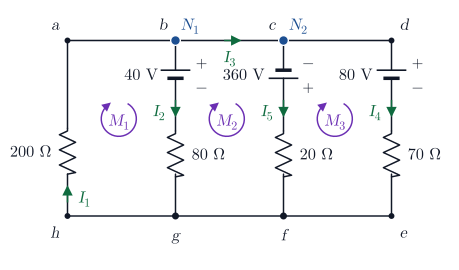

# Ejercicio 15

## Enunciado

Determine la corriente, el voltaje y la potencia disipada en cada una de las resistencias del circuito mostrado en la figura. Asimismo, determine la potencia entregada o absorbida por cada una de las fuentes. Analice los resultados con base en los principios de conservación de la energía y de la carga eléctrica.

## Solución

Nodos: $N_1$ (punto $b$, une $a$–$b$) y $N_2$ (punto $c$, une $c$–$d$), unidos por el cable $b$–$c$, por el que circula $I_3$; el riel inferior ($e$–$f$–$g$–$h$) es el tercer nodo. Corrientes supuestas: $I_1$ sube por $200\,\Omega$ y llega a $N_1$; $I_2$ baja por la rama de $40\,\mathrm{V}$; $I_3$ va de $N_1$ a $N_2$; $I_5$ baja por la rama de $360\,\mathrm{V}$; $I_4$ va de $N_2$ hacia $d$ y baja por la rama de $80\,\mathrm{V}$. Mallas en sentido horario. Se usa $360\,\mathrm{V}$ (valor impreso).

> **Fórmulas:** Nodos: $\sum I_{entra}=\sum I_{sale}$ ;  Mallas: $\sum V=0$ ;  $R$ con $I$: $-IR$, contra $I$: $+IR$ ; fuente $-\to+$: $+\varepsilon$,  $+\to-$: $-\varepsilon$ ;  $P=I^2R$ ;  $P=\varepsilon I$
>
> Ecuaciones: $(\text{nodos}-1)=3-1=2$ de nodo y $3$ de malla para las $5$ corrientes.

### Sistema de ecuaciones

$$
N_1:\quad I_1=I_2+I_3 \tag{1}
$$
$$
N_2:\quad I_3=I_5+I_4 \tag{2}
$$
$$
M_1\ (h\to a\to b\to g\to h):\quad -200\,I_1-40-80\,I_2=0 \tag{3}
$$
$$
M_2\ (b\to c\to f\to g\to b):\quad +360-20\,I_5+80\,I_2+40=0 \tag{4}
$$
$$
M_3\ (c\to d\to e\to f\to c):\quad -80-70\,I_4+20\,I_5-360=0 \tag{5}
$$

En $M_2$ el cable $b$–$c$ no aporta voltaje (no tiene resistencia).

### Solución

De (4):

$$
20\,I_5=400+80\,I_2\qquad\Rightarrow\qquad I_5=20+4\,I_2
$$

De (5), reemplazando $I_5$:

$$
70\,I_4=20\,I_5-440=20\,(20+4\,I_2)-440=80\,I_2-40\qquad\Rightarrow\qquad I_4=\frac{8\,I_2-4}{7}
$$

De (3):

$$
200\,I_1=-40-80\,I_2\qquad\Rightarrow\qquad I_1=-\frac{1+2\,I_2}{5}
$$

De (2):

$$
I_3=I_4+I_5=\frac{8\,I_2-4}{7}+20+4\,I_2
$$

En (1), multiplicando por $35$:

$$
-7\,(1+2\,I_2)=35\,I_2+5\,(8\,I_2-4)+700+140\,I_2
$$

$$
-7-14\,I_2=215\,I_2+680\qquad\Rightarrow\qquad 229\,I_2=-687
$$

$$
\boxed{I_2=-3.00\,\mathrm{A}}\qquad \boxed{I_5=20+4\cdot(-3)=8.00\,\mathrm{A}}\qquad \boxed{I_4=\frac{8\cdot(-3)-4}{7}=-4.00\,\mathrm{A}}
$$

$$
\boxed{I_1=-\frac{1+2\cdot(-3)}{5}=1.00\,\mathrm{A}}\qquad \boxed{I_3=I_4+I_5=-4+8=4.00\,\mathrm{A}}
$$

Signos negativos: por la rama de $40\,\mathrm{V}$ la corriente realmente **sube** ($3.00\,\mathrm{A}$) y por la rama de $80\,\mathrm{V}$ también **sube** ($4.00\,\mathrm{A}$). Las demás tienen el sentido supuesto: $1.00\,\mathrm{A}$ sube por $200\,\Omega$, $4.00\,\mathrm{A}$ van de $N_1$ a $N_2$ por el cable y $8.00\,\mathrm{A}$ bajan por la rama de $360\,\mathrm{V}$.

| Elemento | $I$ (A) | $\Delta V$ (V) | $P$ (W) |
|---|---|---|---|
| $200\,\Omega$ | $1.00$ | $200$ | $200$ |
| $80\,\Omega$ | $3.00$ | $240$ | $720$ |
| $20\,\Omega$ | $8.00$ | $160$ | $1280$ |
| $70\,\Omega$ | $4.00$ | $280$ | $1120$ |
| **Total disipado** |  |  | $\mathbf{3320}$ |
| $40\,\mathrm{V}$: sube, entra por $-$ y sale por $+$ $\Rightarrow$ **entrega** | $3.00$ | $40$ | $120$ |
| $360\,\mathrm{V}$: baja, entra por $-$ (arriba) y sale por $+$ $\Rightarrow$ **entrega** | $8.00$ | $360$ | $2880$ |
| $80\,\mathrm{V}$: sube, entra por $-$ y sale por $+$ $\Rightarrow$ **entrega** | $4.00$ | $80$ | $320$ |
| **Total entregado** |  |  | $\mathbf{3320}$ |

**Carga:** en $N_1$, $I_1=I_2+I_3$: $1.00=-3.00+4.00$ ✓; en $N_2$, $I_3=I_5+I_4$: $4.00=8.00+(-4.00)$ ✓.  
**Energía:** entregada $3320\,\mathrm{W}$ $=$ disipada $3320\,\mathrm{W}$. ✓  Además, $V_{N_1}-V_{inf}=V_{N_2}-V_{inf}=-200\,\mathrm{V}$ en todas las ramas (el cable $b$–$c$ no tiene caída de voltaje).
